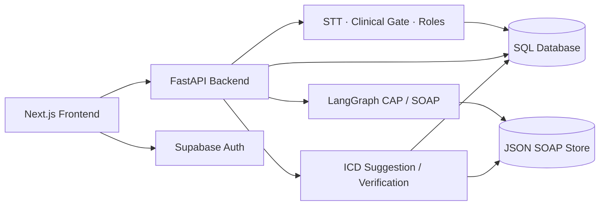

# Architecture Overview — ClinNote AI P-006

Tài liệu kiến trúc chính của dự án:

- [Architecture Diagram](docs/architecture_diagram.md): system overview, data flow, storage, deployment và các phần còn thiếu.
- [Transcript-to-SOAP Pipeline](docs/TRANSCRIPT_TO_SOAP_PIPELINE.md): hợp đồng chi tiết của pipeline `Transcript → CAP → SOAP → review/approve`.
- [SOAP Evaluation Report](eval/soap/report.md): kết quả đánh giá và giới hạn bằng chứng.
- [Backend Source Architecture](src/ARCHITECTURE.md): ranh giới module trong `src/`.

## Current Architecture

## Boundaries

- SQL database lưu người dùng, bệnh nhân, consultation, transcript, SOAP tóm tắt và ICD suggestion.
- JSON SOAP Store lưu snapshot nguồn, CAP, attempts và lịch sử revision/final theo `run_id`.
- LangGraph chỉ điều phối hai operation SOAP: extract và render. Review/approve/export đi qua service riêng.
- Clinical gate chạy trước phân vai audio và trước khi tạo CAP từ transcript.
- Pipeline hiện xử lý theo request/response; chưa có SSE, WebSocket hoặc streaming.
- Vector Store/RAG, FHIR/EHR, Event Consolidation, tự chẩn đoán và kê đơn không thuộc implementation hiện tại.

## Known Gaps

- JSON final, `soap_notes` và dữ liệu chuyển sang PDF chưa có transaction/revision đồng bộ thống nhất.
- Frontend có Supabase session nhưng backend API chưa có lớp xác thực/phân quyền tương ứng cho toàn bộ endpoint.
- UI approve hiện có thể tự chuẩn bị trạng thái review; cần nghiệm thu việc người dùng thực sự kiểm tra từng item.
- Backend/model end-to-end trên deployment công khai và PDF toàn luồng chưa được xác nhận.
