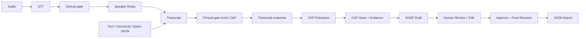
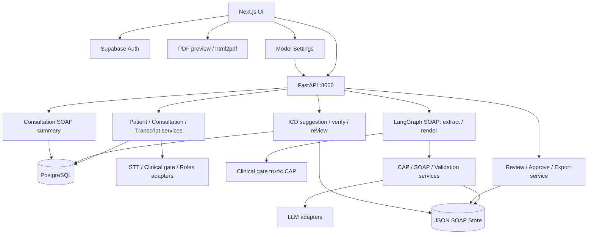

# ClinNote AI — P-006

> Hội thoại bác sĩ–bệnh nhân → clinical facts có evidence → SOAP draft để người review kiểm tra, chỉnh sửa và approve.

ClinNote AI hỗ trợ ghi chép lượt khám bằng tiếng Việt. Dự án kết hợp Speech-to-Text (STT), phân vai người nói và pipeline **Transcript → CAP → SOAP**. CAP (*Clinical Atomic Propositions*) là từng thông tin lâm sàng nhỏ, gắn với lời thoại nguồn để người review đối chiếu trước khi duyệt.

**Status: MVP đang phát triển.** Đã có backend, frontend và kết quả đánh giá trên hội thoại tổng hợp; nghiệm thu toàn luồng giao diện và review nội dung độc lập còn thiếu. Xem [Pipeline Documentation](docs/TRANSCRIPT_TO_SOAP_PIPELINE.md) và [Eval Evidence](eval/results/evidence-2026-10-02.md) để đối chiếu implementation và bằng chứng đã lưu trong repo.

**Live demo:** [https://c4-app-006.vercel.app/](https://c4-app-006.vercel.app/)

README được đối chiếu với code tại commit **`8741183` ngày 2026-10-14**. Các kết quả model/test cũ giữ ngày chạy riêng; cập nhật tài liệu không đồng nghĩa đã nghiệm thu lại sản phẩm.

**Contents:** [Problem](#problem) · [Solution](#solution) · [Target User](#target-user) · [Features](#features--current-status) · [Workflow](#workflow) · [Demo](#demo) · [Tech Stack](#tech-stack) · [Quick Start](#quick-start) · [Environment Variables](#environment-variables) · [Sample Input](#sample-input--expected-behavior) · [Architecture](#architecture--project-structure) · [API](#api-overview) · [Testing](#testing--evaluation) · [Limitations](#known-limitations--deliverables-checklist) · [Team & License](#team--license)

## Problem

Thông tin trong lượt khám nằm rải rác trong hội thoại: triệu chứng, thời gian, thuốc đang dùng, kết quả khám và kế hoạch theo dõi. Người ghi chép cần tổng hợp chúng thành ghi chú có cấu trúc, đồng thời giữ đúng phủ định, sự chưa chắc chắn và các phát biểu được đính chính.

Sinh ghi chú trực tiếp bằng LLM có thể bỏ sót hoặc thêm thông tin, biến kế hoạch thành việc đã thực hiện, hoặc diễn đạt một nghi ngờ thành chẩn đoán chắc chắn. Nếu thiếu evidence, người review khó kiểm tra câu nào xuất phát từ lời thoại nào.

Dự án chưa có khảo sát định lượng hoặc số đo thời gian tiết kiệm tại cơ sở y tế. Các lợi ích này là mục tiêu cần đánh giá, chưa phải kết quả đã chứng minh.

## Solution

ClinNote AI dùng CAP làm lớp trung gian giữa transcript và SOAP:

- **CAP Extraction:** tách các clinical facts, giữ speaker, thời gian, phủ định, uncertainty và trạng thái thuốc/kế hoạch.
- **Evidence Grounding:** nối từng CAP với quote nguyên văn trong transcript; câu SOAP tham chiếu CAP để truy ngược nguồn.
- **SOAP Rendering:** sinh draft từ transcript và CAP đã lưu; phần thiếu thông tin được giữ thiếu để review.
- **Human Review:** người review kiểm tra evidence, sửa câu, xử lý cảnh báo, lưu revision và approve bản cuối.

SOAP gồm **Subjective** (thông tin bệnh nhân kể), **Objective** (quan sát/kết quả khám), **Assessment** (nhận định) và **Plan** (kế hoạch). Mục tiêu là hỗ trợ ghi chép; quyết định chuyên môn vẫn thuộc người review.

## Target User

- **Primary:** bác sĩ/người ghi chép cần tổng hợp hội thoại thành SOAP và đối chiếu từng câu với nguồn.
- **Secondary:** nhóm phát triển và reviewer đánh giá khả năng giữ thông tin, xử lý đính chính và truy vết của pipeline.
- **Current use:** demo, phát triển và đánh giá với dữ liệu tổng hợp; chưa nghiệm thu để sử dụng trên hồ sơ bệnh nhân thật.

## Features & Current Status

“Đã triển khai” mô tả code hiện có; mức kiểm chứng đối chiếu [pipeline docs](docs/TRANSCRIPT_TO_SOAP_PIPELINE.md), [evaluation report](eval/soap/report.md) và [evidence ngày 2026-10-02](eval/results/evidence-2026-10-02.md), không thay cho nghiệm thu sản phẩm.

| Feature | Implementation | Verification / remaining work |
|---|---|---|
| Audio upload và transcript có phân vai | Có luồng Blaze; có adapter Whisper qua 9router/Groq | Có test giả lập và STT ping thật; chưa chấm chất lượng hội thoại audio thật |
| Clinical gate — kiểm tra ngữ cảnh khám bệnh | Kiểm tra sau STT trước phân vai audio, và trước khi lưu snapshot/trích CAP; mặc định dùng JEV/OpenRouter | Có code và test; chưa có đánh giá độc lập về độ đúng của gate |
| Nhập transcript dạng text, canonical JSON, Qwen JSON | Có parser và UI `/soap`; có Test import ở lượt khám | Có test cấu trúc/adapter; thao tác UI toàn luồng còn chờ xác nhận |
| CAP Extraction và SOAP Rendering | LangGraph có hai operation độc lập | Báo cáo ngày 2026-09-27 ghi nhận 8/8 ca tổng hợp có output ở mỗi hướng |
| Evidence view | Liên kết SOAP → CAP → quote, speaker, segment và timestamp khi có | Kiểm tra ID/quote bằng code; nội dung được nguồn hỗ trợ cần người review xác nhận |
| Revision, review, approve, JSON export | API và workspace chung cho `/soap`, `/encounters/[id]`; UI có nút Ký duyệt bệnh án | Có ca API/store đến final và mở lại; UI hiện tự điền trạng thái review khi duyệt, chưa bảo đảm từng câu đã được người dùng kiểm tra |
| Lưu SOAP theo lượt khám | GET/POST consultation SOAP lưu/đọc S/O/A/P, run ID, version và status trong database; frontend gửi DRAFT | Đồng bộ final và kiểm soát revision/review giữa database và JSON store chưa hoàn chỉnh |
| Xem/xuất PDF | Có màn `/encounters/[id]/pdf` để cấu hình và xuất bệnh án | Có code frontend; chưa xác nhận PDF trọn luồng hoặc đối chiếu với final revision đã duyệt |
| Model Settings | Cấu hình riêng STT, roles, CAP và SOAP; model catalog và Ping | Có test transport/credential isolation; chưa xác nhận mọi provider/UI |
| CAP quarantine, semantic validation và coverage checks | CAP chưa đủ điều kiện không đưa vào renderer; phân loại lỗi structural/safety, giới hạn repair | Có regression tests trong bản tích hợp với `main`; không thay thế human review |
| ICD-10 suggestion (LLM + verify) | POST `/api/v1/icd/suggest` từ run đã trích CAP; mỗi mã được verify qua icd.kcb.vn trước khi trả về; lưu/duyệt theo consultation | Có unit test loại mã not-grounded; chưa có nghiệm thu UI toàn luồng |

## Workflow



Sơ đồ thể hiện đường đi khi gate trả `CLINICAL`. Với audio, `NON_CLINICAL` dừng phân vai; `UNCERTAIN` lưu transcript chưa phân vai để kiểm tra. Với extract SOAP, cả hai trạng thái bị từ chối bằng HTTP 422; lỗi kỹ thuật gate trả 502 và chưa tạo run. Gate SOAP kiểm tra lại ngữ cảnh, không gọi lại STT hoặc phân vai.

Extract dừng sau khi lưu CAP. Generate là request mới, đọc snapshot đã lưu để tạo SOAP; không chạy lại STT, gate hoặc trích CAP. Graph quản lý tối đa một lần repair ở mỗi bước CAP/SOAP cho các mã lỗi được cho phép; có cả lỗi cấu trúc và một số lỗi diễn đạt/ngữ nghĩa, không chỉ JSON sai cú pháp. Xem [repair policy](src/services/soap/repair_policy.py).

Khi review, truy theo chuỗi **SOAP item → CAP → transcript quote**. Liên kết hợp lệ chứng minh ID/quote khớp; độ đúng của toàn bộ nội dung câu cần được đánh giá riêng. Sửa transcript tạo run mới; các run cũ giữ snapshot nguồn riêng.

## Demo

### Transcript-only demo

Cách thử ngắn nhất dùng `/soap`, không cần tạo bệnh nhân, upload audio hoặc đăng nhập Supabase. Backend vẫn cần URL/driver database hợp lệ lúc import, cấu hình JEV/OpenRouter cho clinical gate và provider LLM cho CAP/SOAP theo [Quick Start](#quick-start).

1. Chạy backend và frontend theo [Quick Start](#quick-start).
2. Mở `http://127.0.0.1:3000/soap`; chọn **Dùng mẫu giả lập**, hoặc dán [Sample Input](#sample-input--expected-behavior) vào thẻ **Hội thoại chữ**.
3. Bấm **Lưu hội thoại và tách nguồn** để trích CAP, rồi **Tạo SOAP từ nguồn đã lưu**.
4. Chọn câu SOAP/CAP để xem quote và lượt thoại nguồn. Kiểm tra đúng speaker, phủ định, uncertainty và kế hoạch.
5. Kiểm tra nội dung và evidence từng item trước khi bấm **Ký duyệt bệnh án**. UI hiện tự chuẩn bị trạng thái review và lưu revision trước approve khi cần; xem giới hạn ở [Workflow](#workflow).
6. Dùng **Tải JSON bệnh án**, rồi mở lại `/soap?run=<run_id>` để kiểm tra revision đã lưu.

Nút dùng mẫu chỉ điền hội thoại; gate/extract/generate vẫn gọi model thật và có thể phát sinh chi phí. Sau generate, UI còn thử gọi ICD suggestion trong nền; lỗi nhánh này không chặn SOAP. Tên reviewer có thể lấy từ profile hoặc giá trị mặc định; nhãn “Ký duyệt” chưa phải chữ ký số/xác thực bác sĩ.

### Encounter demo

Luồng đầy đủ cần đăng nhập Supabase và PostgreSQL đã chuẩn bị.

Tạo bệnh nhân/lượt khám bằng dữ liệu tổng hợp → mở `/encounters/<id>` → **Tải lên** hoặc **Ghi âm** → kiểm tra transcript → tạo CAP/SOAP trong cột SOAP → review/approve. Thẻ **Test import** nhận Qwen/canonical JSON, tạo run thử riêng và không thay audio/transcript của lượt khám.

## Tech Stack

| Layer | Technology |
|---|---|
| AI Agent | LangGraph, LangChain; graph SOAP riêng cho extract/render |
| Backend | FastAPI, Uvicorn, Python; Pydantic validation/settings |
| Frontend | Next.js 16, React 19, TypeScript, Tailwind CSS |
| Speech-to-Text | Blaze; Whisper-compatible transport qua 9router/Groq |
| LLM | 9router, OpenAI, Ollama; lựa chọn Gemini/OpenRouter/Groq trong Model Settings |
| Clinical gate & default roles | JEV qua OpenRouter Decisions API; cấu hình riêng `OPENROUTER_JEV_MODEL` |
| Database & Auth | SQLAlchemy, PostgreSQL/Supabase cho luồng lượt khám; Supabase Auth trên frontend |
| SOAP Storage | JSON files có snapshot/hash và revision trong `data/soap_mvp/` |
| Testing | pytest, pytest-asyncio, HTTPX, Ruff, ESLint, TypeScript |
| DevOps | Docker backend, Docker Compose, GitHub Actions CI cho backend |

Dependency backend nằm trong [requirements.txt](requirements.txt); frontend trong [package.json](frontend/package.json) và [package-lock.json](frontend/package-lock.json). Vector store/RAG chưa thuộc pipeline SOAP hiện tại.

## Quick Start

### Prerequisites

- Python **3.11** là phiên bản CI/Docker đang dùng.
- Node.js **22+**, npm và Git cho frontend; các package Supabase trong lockfile yêu cầu Node ≥22.
- Một provider LLM với model/key hợp lệ để chạy CAP/SOAP. 9router/Ollama là dịch vụ riêng, repo không tự khởi động chúng.
- OpenRouter key có quyền gọi JEV cho clinical gate mặc định, kể cả khi chỉ nhập transcript và dùng provider khác cho CAP/SOAP.
- PostgreSQL/Supabase và tài khoản đăng nhập chỉ cần cho luồng lượt khám đầy đủ. Transcript-only demo dùng SQLite in-memory để app import mà không kết nối database thật.

Các lệnh dưới đây dùng Bash trên Linux/macOS. Windows có thể chạy bằng WSL; PowerShell activate venv bằng `.venv\Scripts\Activate.ps1`.

### 1. Clone & install backend

```bash
git clone https://github.com/AI20K-Build-Phase-Cohort-4/P-006.git
cd P-006
python3.11 -m venv .venv
source .venv/bin/activate
python -m pip install -r requirements.txt
```

Với checkout đã có sẵn, dùng môi trường hiện tại hoặc tạo venv mới với tên riêng; không cần clone hoặc tạo lại venv.

### 2. Configure backend

Nếu chưa có `.env`, tạo từ `.env.example`. Nếu đã có, giữ file hiện tại và chỉnh các biến cần thiết. Với LLM mặc định qua 9router, cấu hình tối thiểu sau là **ví dụ**, không phải key/model đã được cấp sẵn:

```dotenv
APP_ENV=development
SOAP_ENABLED=true
DB_AUTO_CREATE_TABLES=false
DATABASE_URL=sqlite:///:memory:
SOAP_DATA_DIR=./data/soap_mvp
CORS_ORIGINS=http://localhost:3000,http://127.0.0.1:3000

LLM_PROVIDER=9router
NINEROUTER_BASE_URL=http://127.0.0.1:20128/v1
NINEROUTER_API_KEY=YOUR_9ROUTER_API_KEY
NINEROUTER_MODEL=YOUR_ACCESSIBLE_MODEL_ID

# Clinical gate và phân vai mặc định dùng JEV qua OpenRouter
OPENROUTER_API_KEY=YOUR_OPENROUTER_API_KEY
OPENROUTER_JEV_MODEL=typesafe/jev-1.13

# Demo không gửi LangSmith trace nếu không cần
LANGCHAIN_TRACING_V2=false
```

Thay các placeholder bằng cấu hình được provider của bạn cấp. `.env.example` đã có `NINEROUTER_*` dưới dạng comment; bỏ comment và điền giá trị trong `.env`. Nếu dùng OpenAI cho CAP/SOAP, đặt `LLM_PROVIDER=openai`, `OPENAI_API_KEY` và `MODEL_NAME` thay cho nhóm 9router; vẫn giữ key/model OpenRouter cho gate.

Không cần key STT khi chỉ nhập transcript. Tuy nhiên, gate SOAP hiện gọi cấu hình roles mặc định phía backend: `LLM_PROVIDER` và override CAP/SOAP không đổi provider của gate. Thiếu `OPENROUTER_API_KEY` có thể làm extract thất bại với `gate_technical_failure` trước khi trích CAP. `OPENROUTER_MODEL` là model LLM thông thường, khác `OPENROUTER_JEV_MODEL` của JEV.

### 3. Run backend

Từ thư mục gốc, sau khi activate venv:

```bash
APP_ENV=development SOAP_ENABLED=true DB_AUTO_CREATE_TABLES=false \
DATABASE_URL=sqlite:///:memory: \
python -m uvicorn src.main:app --host 127.0.0.1 --port 8000 --workers 1
```

Lệnh này dành cho transcript-only demo; các giá trị trên command line ghi đè `.env`. SOAP vẫn lưu ở `SOAP_DATA_DIR`, còn SQLite in-memory không có dữ liệu lượt khám. Một worker là cấu hình demo cho JSON store hiện tại.

### 4. Run frontend

Mở terminal thứ hai:

```bash
cd P-006/frontend
npm install --ignore-scripts
```

Nếu terminal đã ở thư mục gốc repo, dùng `cd frontend`. Tạo `frontend/.env.local` nếu chưa có và đặt:

```dotenv
NEXT_PUBLIC_API_URL=http://127.0.0.1:8000
```

```bash
npm run dev -- --hostname 127.0.0.1 --port 3000
```

Mở **http://127.0.0.1:3000/soap**. Không cần cấu hình Supabase cho route demo độc lập này.

### 5. Verify startup

```bash
curl --fail-with-body http://127.0.0.1:8000/health
curl --fail-with-body http://127.0.0.1:8000/openapi.json \
  | python -c 'import json,sys; print("\n".join(p for p in json.load(sys.stdin)["paths"] if p.startswith("/api/v1/soap/")))'
```

Health trả `status=ok`; OpenAPI phải có **6 SOAP paths**. Swagger UI ở **http://127.0.0.1:8000/docs**. `/health` thành công chưa chứng minh SOAP router đã được bật.

### Troubleshooting

| Symptom | Check |
|---|---|
| SOAP API trả 404 | Kiểm tra `APP_ENV=development/test`, `SOAP_ENABLED=true`, rồi restart backend |
| Extract trả 502 `gate_technical_failure` | Kiểm tra OpenRouter key, quyền gọi JEV và `OPENROUTER_JEV_MODEL` |
| Extract trả 422 `clinical_gate` | Hội thoại bị phân loại `NON_CLINICAL` hoặc `UNCERTAIN` |
| CORS lỗi | `NEXT_PUBLIC_API_URL` và `CORS_ORIGINS` phải khớp host/port |
| Không tạo được lượt khám | Dùng PostgreSQL đã có schema và doctor profile hợp lệ |
| Revision trả 409 | Đọc lại run và gửi đúng `expected_revision` mới nhất |

## Environment Variables

Backend đọc `.env` từ root repo; frontend dùng `frontend/.env.local`.

| Variable | Scope |
|---|---|
| `APP_ENV`, `SOAP_ENABLED` | Mount SOAP/model-settings API trong development/test |
| `DATABASE_URL`, `DB_AUTO_CREATE_TABLES` | Database và hành vi startup |
| `SOAP_DATA_DIR` | Nơi lưu snapshot, CAP và revisions |
| `LLM_PROVIDER` | Provider mặc định: `9router`, `openai`, `ollama` |
| `NINEROUTER_*`, `OPENAI_*`, `OLLAMA_*` | Cấu hình provider CAP/SOAP |
| `OPENROUTER_API_KEY`, `OPENROUTER_JEV_MODEL` | Clinical gate và roles mặc định |
| `BLAZE_*`, `GROQ_*` | STT tùy chọn |
| `NEXT_PUBLIC_API_URL` | Backend URL cho frontend |
| `NEXT_PUBLIC_SUPABASE_*` | Auth và luồng lượt khám |
| `PARSE_API_KEY`, `PARSE_ICD_BASE_URL` | ICD lookup/verify tùy chọn |

Không đặt provider secret hoặc database password trong biến `NEXT_PUBLIC_*`. Danh sách đầy đủ, default và giới hạn xem [.env.example](.env.example) và [src/config.py](src/config.py).

## Sample Input & Expected Behavior

Ví dụ dưới đây là **synthetic data** và chỉ minh họa điều người review cần kiểm tra.

```text
Patient: Tôi đau gối trái ba ngày.
Doctor: Khám thấy gối trái sưng nhẹ.
Doctor: Có thể là viêm khớp.
Doctor: Nếu còn đau thì tái khám tuần sau.
```

| CAP/evidence | Expected SOAP behavior |
|---|---|
| Đau gối trái ba ngày — lời bệnh nhân | **S:** giữ vị trí và thời gian |
| Gối trái sưng nhẹ — quan sát bác sĩ | **O:** chỉ ghi quan sát đã nêu |
| Có thể viêm khớp — nhận định bác sĩ | **A:** giữ uncertainty |
| Tái khám nếu còn đau — kế hoạch bác sĩ | **P:** giữ điều kiện, không diễn đạt đã thực hiện |

Nếu transcript không có dữ liệu cho một section, output phải đặt `items=[]` và `missing=true`. Bộ ca tổng hợp và input canonical/Qwen nằm trong [eval/soap/cases.json](eval/soap/cases.json) và [pipeline documentation](docs/TRANSCRIPT_TO_SOAP_PIPELINE.md).

## Architecture & Project Structure



Database lưu bệnh nhân, lượt khám, transcript và bản SOAP tóm tắt của consultation. JSON store giữ input snapshot, CAP, attempts và lịch sử revision của từng run. Hai nơi lưu chưa có hợp đồng đồng bộ final hoàn chỉnh.

```text
P-006/
├── src/                    # FastAPI, agents, schemas, services và models
├── frontend/src/           # Next.js routes, components và API clients
├── tests/                  # pytest; SOAP dùng fake LLM và temp store
├── eval/soap/              # Synthetic cases, runner và report
├── data/soap_mvp/          # Runtime snapshots và revisions
├── docs/                   # Architecture và pipeline documentation
├── scripts/                # Supabase schema và AI logging
├── presentation/           # Demo Day materials
├── Dockerfile
└── docker-compose.yml
```

Đọc sâu: [Architecture Diagram](docs/architecture_diagram.md) → [Transcript-to-SOAP Pipeline](docs/TRANSCRIPT_TO_SOAP_PIPELINE.md) → [SOAP Graph](src/agents/soap_graph.py) → [Evaluation Report](eval/soap/report.md).

## API Overview

Base URL local: `http://127.0.0.1:8000`. Request/response đầy đủ xem Swagger tại `/docs`.

| Group | Main endpoints |
|---|---|
| Health | `GET /health`, `GET /api/v1/status` |
| Patients & consultations | `POST /api/v1/patients`, `POST/GET /api/v1/consultations` |
| Audio & transcript | `POST /api/v1/consultations/{id}/audio`, `GET /api/v1/consultations/{id}/transcript` |
| SOAP | `POST /api/v1/soap/extract-caps`, `POST /api/v1/soap/runs/{run_id}/generate` |
| Review | `GET /runs/{run_id}`, `POST /revisions`, `POST /approve`, `GET /export` dưới prefix `/api/v1/soap` |
| Model settings | `POST /api/v1/model-settings/models`, `POST /api/v1/model-settings/ping` |
| ICD | `GET /api/v1/icd/search`, `POST /api/v1/icd/suggest`, consultation suggestion CRUD |

SOAP APIs chỉ mount khi `SOAP_ENABLED=true` và `APP_ENV=development/test`. Validation lỗi trả 422; revision stale hoặc chưa đủ điều kiện approve trả 409.

## Testing & Evaluation

### Local checks

Từ root repo, sau khi activate venv:

```bash
ruff check src/ tests/
pytest tests/ -v
python eval/soap/run_eval.py
```

Trong `frontend/`:

```bash
npm run lint
npx tsc --noEmit --incremental false
npm run build
```

SOAP tests dùng fake LLM/HTTP provider, SQLite in-memory và store tạm. Evaluator mặc định chỉ xác thực cấu trúc/quote của 8 ca tổng hợp, không gọi model.

### Live model evaluation

Sau khi kiểm tra provider, chạy từ root với backend SOAP đang hoạt động:

```bash
python eval/soap/run_eval.py --run-model --limit 1
```

Đây là lượt gọi thật và có thể tính phí. Bắt đầu với một ca trước khi mở rộng số lượng.

**Trạng thái bằng chứng:**

- Lượt model thật ngày 2026-09-27 có output cho 8/8 ca ở cả baseline và CAP pipeline.
- Evidence ngày 2026-10-02 có 5/5 ca tạo output; các review vẫn `pending_human_review`.
- Lần đối chiếu code `8741183` ngày 2026-10-14 còn 17 lỗi Ruff; chưa chạy lại pytest, frontend lint/build, browser hoặc model thật trong lượt cập nhật README.
- Các lượt đánh giá cũ diễn ra trước clinical gate và cập nhật UI/database tháng 10, nên không đại diện đầy đủ cho pipeline hiện tại.

Chi tiết token, latency, từng case và giới hạn xem [Evaluation Evidence Summary](eval/results/report.md), [eval/soap/report.md](eval/soap/report.md) và [evidence ngày 2026-10-02](eval/results/evidence-2026-10-02.md). Không kết luận chất lượng lâm sàng khi chưa có review độc lập.

## Known Limitations & Deliverables Checklist

### Known limitations

- **Clinical validation:** chưa có review độc lập trên hội thoại thật; không tuyên bố đã giảm hallucination hoặc tiết kiệm thời gian bằng số liệu lâm sàng.
- **Acceptance issues:** audit local trước đây ghi nhận lỗi đọc run khi attempt ghi dở, suy trạng thái superseded, chuyển section phải review lại và chuẩn hóa lỗi khởi tạo model. `main` đã bổ sung nhiều kiểm tra grounding/semantic; cần tái nghiệm thu từng tình huống trên bản tích hợp, không suy rằng tất cả lỗi cũ đã hết chỉ từ số test đạt.
- **UI verification:** chưa có bằng chứng thao tác trọn luồng từ nhập → sửa → duyệt → mở lại trên browser cho mọi màn.
- **Review enforcement:** UI tự điền trạng thái review/support, quyết định cảnh báo và tên mặc định khi approve. Chưa bảo đảm người dùng đã review từng câu; nhãn ký duyệt chưa phải chữ ký số. JSON API kiểm tra các trạng thái nhận được, không xác minh thao tác review thực tế.
- **Audio quality:** Whisper suy vai từ text; có thể từ chối segment chứa nhiều vai/thiếu ngữ cảnh. Confidence phân vai không phải độ tin cậy SOAP.
- **Storage & concurrency:** JSON store demo dùng một worker. Consultation đã có API lưu/đọc SOAP tóm tắt/run ID và frontend gửi DRAFT; đồng bộ final cùng kiểm soát revision/review giữa database và JSON store chưa hoàn chỉnh. Database API có thể cập nhật note hiện có, không bảo đảm final bất biến như revision artifacts.
- **PDF:** đã có màn cấu hình/xuất frontend; dữ liệu chuyển màn có cache `sessionStorage`, chưa được backend đối chiếu final revision và chưa nghiệm thu output PDF trọn luồng.
- **Security & deployment:** backend demo chưa có xác thực API tương ứng với frontend login. Docker Compose hiện chỉ cấu hình backend, không phải full stack frontend/database/provider; chưa dùng để công khai demo hồ sơ.
- **Scope:** ICD lookup có code riêng nhưng không thuộc nghiệm thu CAP/SOAP; Event Consolidation, FHIR/EHR integration, tự chẩn đoán/kê đơn và RAG nằm ngoài phạm vi hiện tại.
- **ICD suggestion:** code chỉ giữ CAP `resolution_status=current`, loại suggestion thiếu liên kết CAP hợp lệ và giới hạn confidence khi CAP chưa chắc chắn. Yêu cầu không dùng CAP `negated`/`planned` nằm trong prompt, chưa có bộ lọc code riêng bảo đảm điều này. Verify qua Parse/icd.kcb.vn xác nhận mã tồn tại, không xác nhận mã phù hợp lâm sàng. Lượt gợi ý LLM và verify có thể dùng hạn mức riêng; thiếu `PARSE_API_KEY` có thể khiến không có suggestion sau khi LLM đã được gọi. Mã gợi ý không tự append vào SOAP; người dùng vẫn phải chủ động chọn (ACCEPTED). `/soap` demo không lưu suggestion xuống DB.

Ưu tiên tiếp theo: kiểm soát review thực tế và đồng bộ final/revision → tái nghiệm thu các edge cases lưu/grounding → xác nhận UI/PDF toàn luồng → review nội dung độc lập → hoàn thiện demo artifacts. Không đánh dấu task triển khai DONE chỉ vì README đã đầy đủ.

### Deliverables Checklist

Checklist này phản ánh bằng chứng trong checkout/tài liệu hiện hành, không xác nhận đã nộp hoặc đã được chấm. Các mục chưa hoàn tất ghi rõ phần còn thiếu.

- [x] **Source Code:** backend, frontend và tests có trong repo P-006.
- [x] **README.md:** mô tả sản phẩm, setup, environment variables, samples và giới hạn.
- [x] **Architecture Diagram:** sơ đồ MVP trong README và [docs/architecture_diagram.md](docs/architecture_diagram.md).
- [x] **AI Logs:** 4/4 thành viên đạt tối thiểu 10 log/người trên Phoenix; ảnh ghi nhận Thắng 132, Đoàn 847, Khuê 137 và Anh 194 log. [Xem bằng chứng](docs/evidence/ai-logs-phoenix.png).
- [x] **Live URL / Deploy:** [c4-app-006.vercel.app](https://c4-app-006.vercel.app/).
- [ ] **Video Demo & Screenshots:** cần ghi nhận ca tổng hợp hoàn tất toàn luồng; hướng dẫn ở [presentation/README.md](presentation/README.md).
- [ ] **Pitch Deck:** có deck cục bộ trong `presentation/...`,
- [x] **Weekly Journal:** có [JOURNAL.md](JOURNAL.md); cập nhật trước bàn giao.
- [x] **Worklog:** có [WORKLOG.md](WORKLOG.md); cập nhật trước bàn giao.
- [x] **Evaluation Evidence:** có 5 ca model thật cùng manifest, output baseline, CAP/SOAP, export, review template và báo cáo trong [`eval/results/`](eval/results/report.md). Human review độc lập và UI acceptance evidence vẫn là giới hạn chưa hoàn tất.

## Team & License

### Team

Repository: **P-006**, AI20K Build Phase Cohort 4.

Vai trò kế thừa bảng Team trên main; trách nhiệm dưới đây tổng hợp theo công việc đã ghi trong [WORKLOG.md](WORKLOG.md) đến ngày 03/10/2026. Các thành viên phối hợp triển khai và review; bảng thể hiện mảng phụ trách chính.

| Member | Role | Responsibilities | Student ID |
|---|---|---|---|
| Kiều Đình Đoàn | Tech Lead / Frontend (phụ trách kỹ thuật, giao diện và trải nghiệm người dùng) | Thiết kế wireframe/screen flow; dựng giao diện Next.js, đăng ký/đăng nhập và các màn hình workflow; cải thiện UI/UX; tổng hợp worklog. | 2A202602936 |
| Nguyễn Hà Khuê | Backend & Architecture (backend, kiến trúc và dữ liệu) | Thiết kế hệ thống, schema database và models; tích hợp LLM provider, sửa lỗi lưu bệnh nhân và sinh SOAP; xây dựng architecture diagram, metrics và test case. | 2A202602938 |
| Nguyễn Hoàng Anh | AI/ML & QA (luồng AI, kiểm thử và demo) | Tích hợp audio → transcript → phân vai → lưu/hiển thị; tinh chỉnh prompt CAP/SOAP và validation; xử lý lỗi CAP → SOAP; tạo voice test và quay video demo MVP. | 2A202602811 |
| Đoàn Quang Thắng | Research & Product (nghiên cứu, PRD, MVP SOAP) | Tổng hợp brief/PRD, chia việc; nghiên cứu hướng sinh SOAP; triển khai và kiểm thử MVP SOAP, hỗ trợ nhiều LLM provider; hoàn thiện README. | 2A202602395 |

### Contributing & License

Dự án phát triển trên AI20K Agent Template; giữ [README_boilerplate.md](README_boilerplate.md) làm khung tham khảo. Đọc [CONTRIBUTING.md](CONTRIBUTING.md) và [SECURITY.md](SECURITY.md) trước khi đóng góp hoặc báo vấn đề bảo mật; tuân thủ hướng dẫn `AGENTS.md` nếu checkout local có file này.

**License:** [MIT](LICENSE). Copyright gốc của template: AI20K Build Phase, 2026.
