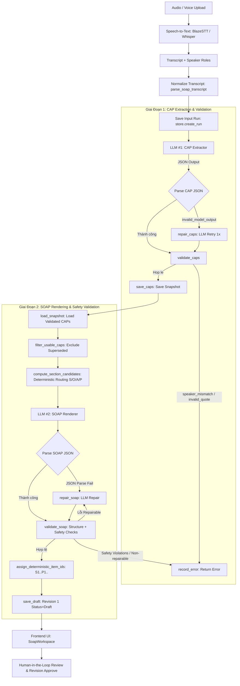
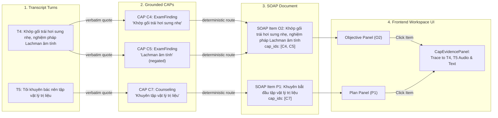

# Kiến Trúc Pipeline Từ Transcript Tới SOAP & CAP Grounding

Tài liệu kỹ thuật tổng quan về kiến trúc, luồng dữ liệu, quy tắc xử lý, cơ chế kiểm soát chất lượng (validation), hệ thống kiểm thử tự động và nguyên lý thiết kế cho pipeline chuyển đổi **Audio/Voice → Transcript → CAP Extraction → Evidence Grounding → CAP Validation → SOAP Rendering → SOAP Validation → Frontend Workspace**.

---

## Mục Lục (Table of Contents)

1. [Tổng Quan Kiến Trúc & End-to-End Data Flow](#1-tổng-quan-kiến-trúc--end-to-end-data-flow)
2. [Luồng Audio / Voice → Transcript (Speech-to-Text & Diarization)](#2-luồng-audio--voice--transcript-speech-to-text--diarization)
3. [Phân Định Speaker (Speaker Identification & Mapping)](#3-phân-định-speaker-speaker-identification--mapping)
4. [Tầng Chuẩn Hóa Transcript (Transcript Normalization)](#4-tầng-chuẩn-hóa-transcript-transcript-normalization)
5. [Trích Xuất CAP — LLM #1 (Clinical Atomic Proposition Extraction)](#5-trích-xuất-cap--llm-1-clinical-atomic-proposition-extraction)
6. [Ngữ Nghĩa Nguồn Fact (CAP Source Semantics: Patient vs Clinician)](#6-ngữ-nghĩa-nguồn-fact-cap-source-semantics-patient-vs-clinician)
7. [Quy Tắc Tự Khai Của Bệnh Nhân (Patient Self-Report Rules)](#7-quy-tắc-tự-khai-của-bệnh-nhân-patient-self-report-rules)
8. [Trích Xuất Comprehensive Findings Của Bác Sĩ (Clinician Objective Exam Findings)](#8-trích-xuất-comprehensive-findings-của-bác-sĩ-clinician-objective-exam-findings)
9. [Tương Tác Thăm Khám & Đau Khi Ấn (Palpation / Physical Exam Interaction)](#9-tương-tác-thăm-khám--đau-khi-ấn-palpation--physical-exam-interaction)
10. [Chẩn Đoán Sơ Bộ & Kế Hoạch Điều Trị (Assessment & Plan Mapping)](#10-chẩn-đoán-sơ-bộ--kế-hoạch-điều-trị-assessment--plan-mapping)
11. [Cơ Chế Bằng Chứng Nguyên Văn (Strict Evidence Grounding & Verbatim Matching)](#11-cơ-chế-bằng-chứng-nguyên-văn-strict-evidence-grounding--verbatim-matching)
12. [Phân Biệt Source Evidence & Contextual Evidence](#12-phân-biệt-source-evidence--contextual-evidence)
13. [Kiểm Tra & Chuẩn Hóa CAP (CAP Validation & Sanitization Snapshot)](#13-kiểm-tra--chuẩn-hóa-cap-cap-validation--sanitization-snapshot)
14. [Dựng Hồ Sơ SOAP — LLM #2 (SOAP Rendering & Clinical-Note Style)](#14-dựng-hồ-sơ-soap--llm-2-soap-rendering--clinical-note-style)
15. [Điều Hướng Ứng Viên Theo Mục (Deterministic Section Candidates Routing)](#15-điều-hướng-ứng-viên-theo-mục-deterministic-section-candidates-routing)
16. [Tạo Định Danh Mục Cố Định (Deterministic Item IDs: S1..P1..)](#16-tạo-định-danh-mục-cố-định-deterministic-item-ids-s1p1)
17. [Kiểm Trả Cấu Trúc & An Toàn Y Khoa (SOAP Structural & Safety Validation)](#17-kiểm-tra-cấu-trúc--an-toàn-y-khoa-soap-structural--safety-validation)
18. [Chính Sách Sửa Lỗi Tự Động (Repair Policy & Fail-Safe HITL)](#18-chính-sách-sửa-lỗi-tự-động-repair-policy--fail-safe-hitl)
19. [Giao Diện Frontend & Luồng Kiểm Duyệt (Frontend Workspace & Review Flow)](#19-giao-diện-frontend--luồng-kiểm-duyệt-frontend-workspace--review-flow)
20. [Nhật Ký Sự Cố Thực Tế & Đã Khắc Phục (Real-World Incident Log)](#20-nhật-ký-sự-cố-thực-tế--đã-khắc-phục-real-world-incident-log)
21. [Bộ Test Suite Tự Động & Hàng Rào Chống Lỗi Cũ (Regression Safeguards)](#21-bộ-test-suite-tự-động--hàng-rào-chống-lỗi-cũ-regression-safeguards)
22. [Phân Tích Thiết Kế Prompt (Prompt Engineering Analysis)](#22-phân-tích-thiết-kế-prompt-prompt-engineering-analysis)
23. [Ví Dụ Minh Họa End-to-End (Concrete End-to-End Walkthrough)](#23-ví-dụ-minh-họa-end-to-end-concrete-end-to-end-walkthrough)
24. [Sơ Đồ Truy Xuất Nguồn Gốc (Traceability Diagram: Turn → CAP → SOAP → UI)](#24-sơ-đồ-truy-xuất-nguồn-gốc-traceability-diagram-turn--cap--soap--ui)
25. [Nguyên Lý Thiết Kế Cốt Lõi (Core Design Principles)](#25-nguyên-lý-thiết-kế-cốt-lõi-core-design-principles)

---

## 1. Tổng Quan Kiến Trúc & End-to-End Data Flow

Pipeline hoạt động theo mô hình **LangGraph StateGraph** 2 giai đoạn (`extract` và `render`), đảm bảo mọi thông tin đưa vào bản ghi SOAP cuối cùng đều phải đi qua một tập các mệnh đề y khoa nguyên tử (Clinical Atomic Propositions - CAPs) được kiểm tra căn cứ (evidence grounding) và xác thực tính an toàn nghiêm ngặt.

### Sơ Đồ Luồng Dữ Liệu Tổng Thể (Mermaid Diagram)



---

## 2. Luồng Audio / Voice → Transcript (Speech-to-Text & Diarization)

### 2.1 Tiếp Nhận File Âm Thanh
- **Endpoint**: `POST /api/v1/consultations/{id}/audio` hoặc `POST /api/v1/transcribe`
- **File formats hỗ trợ**: `.wav`, `.mp3`, `.m4a`, `.aac`, `.ogg`, `.webm`, `.flac`
- **Xử lý tạm thời**: Lưu vết tại `audio/temp` thông qua module `src/services/audio/temp_storage.py`.

### 2.2 Động Cơ Speech-to-Text (STT)
- **Engine mặc định**: **Blaze STT Async** (`src/services/blaze/stt_async.py`) / **Whisper Large v3** (`src/services/stt.py`).
- **Ngôn ngữ**: Tiếng Việt (`vi`).
- **Cấu trúc Output Transcript Turn**:
```json
{
  "turn_id": "T1",
  "source_segment_id": "95673cf1-f08b-45d2-93f1-f23589bfac54",
  "source_speaker_id": "1",
  "speaker": "patient",
  "text": "Chào bác sĩ. Gần đây khớp gối trái của tôi bị đau nhiều quá.",
  "start_ms": 5970,
  "end_ms": 9390,
  "role_confidence": 0.98
}
```

---

## 3. Phân Định Speaker (Speaker Identification & Mapping)

1. **Diarization**: STT trả về `source_speaker_id` (ví dụ `"1"`, `"2"`).
2. **Role Classifier**: Module `src/services/speaker/role_classifier.py` sử dụng heuristic/LLM classifier để gán vai trò:
   - `clinician`: Bác sĩ / Nhân viên y tế.
   - `patient`: Bệnh nhân / Người nhà khai bệnh.
3. **Nguyên Lý Nguồn Sự Thật (`speaker_source`)**:
   - `speaker` của transcript turn thể hiện **ai là người nói** lượt thoại đó.
   - `speaker_source` của CAP thể hiện **AI LÀ NGUỒN CỦA FACT Y KHOA** (Source of Fact).
   - *Ví dụ*: Bác sĩ hỏi `"Vận động có làm đau tăng không?"` (turn clinician), bệnh nhân đáp `"Có, cứ đi lại là đau tăng"` (turn patient). Fact `"Đau tăng khi vận động"` có `speaker_source = "patient"`.

---

## 4. Tầng Chuẩn Hóa Transcript (Transcript Normalization)

Hàm `parse_soap_transcript` (`src/services/transcript/normalizer.py`) nhận dữ liệu thô và chuẩn hóa thành đối tượng `Transcript` (`src/schemas/soap.py`):

- **Input Formats Hỗ Trợ**:
  1. `canonical`: Cấu trúc JSON `Transcript` tiêu chuẩn.
  2. `qwen_role_result`: Dạng phân vai từ pipeline Qwen STT.
  3. `text`: Văn bản thuần phân dòng `Clinician: ... / Patient: ...`.
- **Giới Hạn Kiểm Soát An Toàn**:
  - `soap_max_turns`: Tối đa số lượt thoại.
  - `soap_max_chars`: Tối đa số ký tự transcript.
  - `soap_max_input_bytes`: Tối đa dung lượng payload.
- **Bảo Toàn Ký Tự**: Giữ nguyên vẹn font chữ tiếng Việt, không làm thay đổi các chỉ số sinh tồn và giữ nguyên cấu trúc `turn_id` (`T1`, `T2`, ...).

---

## 5. Trích Xuất CAP — LLM #1 (Clinical Atomic Proposition Extraction)

### 5.1 Định Nghĩa CAP (Clinical Atomic Proposition)
CAP là một **mệnh đề y khoa đơn nhất (atomic)** được trích xuất từ cuộc hội thoại. Không tạo SOAP trực tiếp từ transcript để tránh hiện tượng ảo giác (hallucination) và bỏ sót dữ kiện.

### 5.2 Schema Chi Tiết Của CAP (`src/schemas/soap.py`)

| Trường | Kiểu Dữ Liệu | Giá Trị Hợp Lệ / Mô Tả |
|---|---|---|
| `prop_id` | `str` | Mã định danh duy nhất (ví dụ: `C1`, `C2`, `C3`) |
| `cap_type` | `CapType` | `ChiefComplaint`, `Problem`, `ProblemHistory`, `ExamFinding`, `TestResult`, `MedicationStatement`, `MedicationRequest`, `Order`, `FollowUp`, `Counseling` |
| `canonical_concept` | `str` | Khái niệm lâm sàng chuẩn hóa (ví dụ: `"đau khớp gối"`, `"huyết áp"`) |
| `proposition_text` | `str` | Nội dung mệnh đề khẳng định bằng ngôn ngữ y khoa |
| `speaker_source` | `Literal` | `clinician` hoặc `patient` (Nguồn của fact) |
| `temporality` | `Literal` | `current`, `past`, `future`, `unknown` |
| `verification_status` | `Literal` | `affirmed`, `negated`, `uncertain`, `unknown` |
| `clinical_status` | `Literal` | `active`, `resolved`, `planned`, `unknown` |
| `medication_state` | `Literal/null` | `taking`, `not_taking`, `start_planned`, `stop_planned`, `change_planned`, `unknown`, `null` |
| `evidence` | `list[Evidence]` | Danh sách bằng chứng trỏ trực tiếp về turn_id và quote nguyên văn |
| `supersedes` | `list[str]` | Danh sách prop_id bị thay thế/sửa đổi bởi CAP này |
| `resolution_status` | `Literal` | `current`, `superseded`, `needs_review` |

---

## 6. Ngữ Nghĩa Nguồn Fact (CAP Source Semantics: Patient vs Clinician)

```
[Lời Thoại Trong Transcript] ──► Ai khai báo/quan sát? ──► [speaker_source] ──► [Phân Luồng Candidates]
  - Patient tự khai triệu chứng/tiền sử      ──► patient   ──► Subjective (S)
  - Clinician trực tiếp khám/đo/chỉ định     ──► clinician ──► Objective (O) / Assessment (A) / Plan (P)
```

- **PATIENT SOURCE (`speaker_source = "patient"`)**:
  Dành cho thông tin do bệnh nhân trực tiếp tự khai (Chief Complaint, triệu chứng chủ quan, tiền sử bệnh, tiền sử dùng thuốc, mức độ đau, tác động giấc ngủ).
- **CLINICIAN SOURCE (`speaker_source = "clinician"`)**:
  Dành cho thông tin do bác sĩ trực tiếp khám, đo lường chỉ số, nhận định chẩn đoán sơ bộ, hoặc đưa ra chỉ định/kế hoạch điều trị.
- **Quy Tắc Câu Hỏi Bác Sĩ (Question ≠ Source of Fact)**:
  Câu hỏi của bác sĩ **KHÔNG** biến bác sĩ thành nguồn của triệu chứng bệnh nhân khai.

---

## 7. Quy Tắc Tự Khai Của Bệnh Nhân (Patient Self-Report Rules)

Khi bệnh nhân xác nhận hoặc mô tả triệu chứng của chính họ trong turn có `speaker = "patient"`:
1. `speaker_source` bắt buộc phải là `"patient"`.
2. `cap_type` bắt buộc thuộc nhóm bệnh nhân: `ChiefComplaint`, `Problem`, hoặc `ProblemHistory`.
3. Áp dụng cho:
   - Lý do khám (Chief Complaint)
   - Cơn đau, độ nặng, thời gian kéo dài, yếu tố tăng/giảm đau.
   - Triệu chứng đi kèm, giới hạn vận động, ảnh hưởng giấc ngủ.
   - Tiền sử bệnh nền, tiền sử dùng thuốc do bệnh nhân khai.
   - Sưng / cứng khớp do bệnh nhân tự cảm nhận.
4. **Bản Đồ Xác Thực (Verification Status Mapping)**:
   - Bệnh nhân khẳng định/mô tả triệu chứng: `verification_status = "affirmed"`.
   - Bệnh nhân phủ nhận rõ ràng ("không sốt", "không đau ngực"): `verification_status = "negated"`.
   - Bệnh nhân thể hiện nghi ngờ, không nhớ rõ ("hình như", "không rõ"): `verification_status = "uncertain"`.

---

## 8. Trích Xuất Comprehensive Findings Của Bác Sĩ (Clinician Objective Exam Findings)

Prompt `cap_extraction.txt` yêu cầu trích xuất **toàn bộ và triệt để** các dữ kiện khách quan do bác sĩ khám và ghi nhận, không chỉ trích xuất đại diện:

- **Chỉ Số Sinh Tồn (Vital Signs)**: Mỗi chỉ số đo được (`Huyết áp 128/82`, `Nhịp tim 72`, `Nhịp thở 16`, `Nhiệt độ 37°C`) phải được trích xuất thành **một CAP nguyên tử riêng biệt**.
- **Quan Sát Khám (Physical Inspection)**: Nhìn thấy sưng nhẹ, không biến dạng khớp.
- **Biên Độ Vận Động (Range of Motion - ROM)**: Biên độ gập duỗi bị hạn chế do đau.
- **Nghiệm Pháp Chuyên Khoa (Special Maneuvers)**:
  - Nghiệm pháp Lachman âm tính (`verification_status = "negated"`).
  - Nghiệm pháp McMurray âm tính (`verification_status = "negated"`).
  - Ép vẹo trong/vẹo ngoài gây khó chịu nhẹ (`verification_status = "affirmed"`).

---

## 9. Tương Tác Thăm Khám & Đau Khi Ấn (Palpation / Physical Exam Interaction)

Khi bác sĩ thực hiện thao tác ấn khám hoặc nghiệm pháp và hỏi cảm giác của bệnh nhân:
- *Ví dụ*: Bác sĩ (T24): *"Tôi ấn vào chỗ này bác có thấy đau nhói không?"* → Bệnh nhân (T25): *"Có, chỗ đó thốn lắm."*
- **Quy Tắc Trích Xuất**:
  1. Đây là dấu hiệu ấn đau phát sinh trong lúc bác sĩ khám thể chất (`ExamFinding`).
  2. `speaker_source` bắt buộc là `"clinician"`.
  3. Bằng chứng (`evidence`) bắt buộc phải chứa turn của bác sĩ (`T24`) - nơi mô tả thao tác khám, và có thể chứa turn câu trả lời của bệnh nhân (`T25`) làm bằng chứng bổ trợ (contextual evidence).
  4. **Nghiêm cấm**: Không bao giờ tạo CAP có `speaker_source = "clinician"` mà lại chỉ chứa duy nhất evidence turn của bệnh nhân.

---

## 10. Chẩn Đoán Sơ Bộ & Kế Hoạch Điều Trị (Assessment & Plan Mapping)

### 10.1 Assessment (Đánh Giá / Chẩn Đoán Sơ Bộ)
- Nhận định chẩn đoán sơ bộ của bác sĩ (ví dụ: *"Có khả năng bác đang bị đợt bùng phát thoái hóa khớp gối mức độ nhẹ"*):
  - `cap_type`: `Problem`
  - `speaker_source`: `clinician`
  - `verification_status`: `uncertain` (Bắt buộc giữ tính chất nghi ngờ/sơ bộ, không được tự ý chuyển thành `affirmed`).
  - `clinical_status`: `active`
  - `temporality`: `current`

### 10.2 Plan (Kế Hoạch Điều Trị & Dặn Dò)
Tất cả khuyến cáo và chỉ định điều trị của bác sĩ được phân loại chính xác:
- `Order`: Chỉ định cận lâm sàng (Chụp X-quang, chụp MRI).
- `Counseling`: Hướng dẫn tập vật lý trị liệu, điều chỉnh sinh hoạt, giảm tải trọng gối, dùng gậy/nẹp.
- `MedicationRequest`: Khuyên dùng thuốc giảm đau kháng viêm không steroid (OTC NSAID).
- `FollowUp`: Hẹn tái khám sau 4 tuần.
- **Thuộc Tính Bắt Buộc**: `clinical_status = "planned"`, `temporality = "future"`.

---

## 11. Cơ Chế Bằng Chứng Nguyên Văn (Strict Evidence Grounding & Verbatim Matching)

Mọi CAP phải duy trì liên kết bằng chứng tuyệt đối với transcript theo các quy tắc khắt khe:

1. **Chuỗi Ký Tự Liên Tục Nguyên Văn (Verbatim Contiguous Substring)**: Ký tự trong `evidence.quote` phải xuất hiện chính xác, liền mạch trong text của turn được trỏ bởi `evidence.turn_id`.
2. **Nghiêm Cấm Thay Thế Đại Từ (No Pronoun Substitution)**: Không được thay thế đại từ (như `"nó"`, `"chỗ đó"`, `"việc này"`) bằng danh từ ở câu trước để tự làm câu quote đứng độc lập.
3. **Nghiêm Cấm Thay Đổi Cấu Trúc**: Không diễn dịch (paraphrase), không tóm tắt, không đảo trật tự từ, không gộp nội dung từ nhiều turn vào một quote.
4. **Hỗ Trợ Khớp Không Phân Biệt Hoa/Thường (Case-Insensitive Match)**: Hàm `resolve_conservative_evidence_quote` (`src/services/soap/text_utils.py`) hỗ trợ chuẩn hóa hoa/thường nhẹ nhàng khi kiểm tra substring nhưng giữ nguyên vẹn 100% ký tự thực tế từ transcript.

---

## 12. Phân Biệt Source Evidence & Contextual Evidence

```
CAP Source: "patient"   ──► Evidence Bắt Buộc: Có ít nhất 1 Turn của Patient (Source Evidence)
                            Option: Turn của Clinician làm Contextual Evidence

CAP Source: "clinician" ──► Evidence Bắt Buộc: Có ít nhất 1 Turn của Clinician (Source Evidence)
                            Option: Turn của Patient làm Contextual Evidence
```

- **Source Evidence**: Turn thoại trực tiếp thể hiện sự thật hoặc thao tác khám của speaker_source.
- **Contextual Evidence**: Turn thoại của người đối thoại trước/sau đó, được đính kèm để làm rõ ngữ cảnh cho câu trả lời ngắn (ví dụ câu hỏi của bác sĩ khi bệnh nhân chỉ đáp *"Có"*).

---

## 13. Kiểm Tra & Chuẩn Hóa CAP (CAP Validation & Sanitization Snapshot)

### 13.1 Hàm `validate_caps` (`src/services/soap/validation.py`)
Thực hiện các bước kiểm tra cấu trúc nghiêm ngặt trước khi lưu snapshot:
- **Kiểm tra trùng lặp ID**: Trùng `prop_id` gây ra lỗi `duplicate_prop_id`.
- **Kiểm tra trạng thái thời gian**: CAP `planned` phải có temporality `future`.
- **Kiểm tra Bằng chứng Speaker (`speaker_mismatch`)**: CAP có `speaker_source = "clinician"` phải có ít nhất một evidence turn với `speaker == "clinician"`.
- **Kiểm tra Trích Dẫn (`invalid_quote`)**: Đảm bảo quote tồn tại nguyên văn trong turn text.
- **Phát Hiện Chu Kỳ Thay Thế (`supersedes_cycle`)**: Tránh vòng lặp trong thuộc tính `supersedes`.

### 13.2 Chuẩn Hóa Snapshot (`filter_usable_caps`)
Hàm `filter_usable_caps` loại bỏ tất cả các CAP có `resolution_status == "superseded"` để đảm bảo LLM #2 chỉ làm việc với tập dữ kiện hiện hành (`usable_caps`).

---

## 14. Dựng Hồ Sơ SOAP — LLM #2 (SOAP Rendering & Clinical-Note Style)

### 14.1 Vai Trò Của LLM #2
LLM #2 là **bộ chuyển đổi văn phong y khoa** từ danh sách CAPs đã qua kiểm duyệt sang văn bản SOAP chuyên nghiệp. LLM #2 **KHÔNG** đọc trực tiếp transcript để tự sáng tác hay tóm tắt tự do.

### 14.2 Phong Cách Viết Nhật Ký Lâm Sàng (Clinical-Note Style)
1. Viết dưới dạng ghi chú lâm sàng cô đọng, chuyên nghiệp (ví dụ: *"Đau khớp gối trái kéo dài 3 tuần, đau tăng khi vận động"*).
2. **Loại bỏ hoàn toàn các từ hội thoại và khẩu ngữ**: Không dùng *"Có chứ"*, *"À"*, *"Vâng"*, *"Dạ"*, *"tôi..."*, *"bác..."*, *"bác sĩ..."*.
3. **Không dùng cấu trúc hội thoại**: Không viết *"Bệnh nhân nói rằng..."*.
4. Sử dụng `proposition_text` của CAP làm nguồn ngữ nghĩa chính.

---

## 15. Điều Hướng Ứng Viên Theo Mục (Deterministic Section Candidates Routing)

Module `src/services/soap/renderer.py` tính toán danh sách ứng viên hợp lệ (`section_candidates`) bằng mã lệnh cố định (deterministic python code):

```python
def compute_section_candidates(caps: list[Cap]) -> dict[str, list[str]]:
    return {
        "S": [c.prop_id for c in caps if c.speaker_source == "patient"],
        "O": [c.prop_id for c in caps if c.speaker_source == "clinician" and c.cap_type in {"ExamFinding", "TestResult"}],
        "A": [c.prop_id for c in caps if c.speaker_source == "clinician" and c.cap_type in {"Problem", "ProblemHistory"}],
        "P": [c.prop_id for c in caps if c.speaker_source == "clinician" and c.cap_type in {"MedicationRequest", "Order", "FollowUp", "Counseling"}],
    }
```

---

## 16. Tạo Định Danh Mục Cố Định (Deterministic Item IDs: S1..P1..)

Sau khi LLM #2 trả về bản thảo SOAP, hệ thống ghi đè các `item_id` bằng quy tắc định danh toàn cục cố định thông qua module `src/services/soap/text_utils.py`:

- Mục **S** (Subjective): `S1`, `S2`, `S3`, ...
- Mục **O** (Objective): `O1`, `O2`, `O3`, ...
- Mục **A** (Assessment): `A1`, `A2`, `A3`, ...
- Mục **P** (Plan): `P1`, `P2`, `P3`, ...

Điều này hoàn toàn loại bỏ rủi ro trùng lặp hoặc sai định dạng `item_id` do LLM tạo ra.

---

## 17. Kiểm Tra Cấu Trúc & An Toàn Y Khoa (SOAP Structural & Safety Validation)

### 17.1 Kiểm Tra Cấu Trúc Lâm Sàng (`validate_soap`)
- **Ràng Buộc Mục S (`subjective_source`)**: Mọi CAP được liên kết trong mục S phải có `speaker_source == "patient"`.
- **Ràng Buộc Mục O (`objective_source`)**: Mọi CAP trong mục O phải có `speaker_source == "clinician"` và `cap_type ∈ {"ExamFinding", "TestResult"}`.
- **Ràng Buộc Mục A (`assessment_source`)**: Mọi CAP trong mục A phải có `speaker_source == "clinician"` và `cap_type ∈ {"Problem", "ProblemHistory"}`.
- **Ràng Buộc Mục P (`plan_source`)**: Mọi CAP trong mục P phải có `speaker_source == "clinician"` và `cap_type ∈ {"MedicationRequest", "Order", "FollowUp", "Counseling"}`.

### 17.2 Kiểm Tra An Toàn Y Khoa Dựa Trên Thuật Toán (`semantic_validator.py`)
Hàm `check_item_safety` thực hiện các kiểm tra an toàn bằng thuật toán mã nguồn (deterministic safety checks):
1. **Kiểm tra con số & liều lượng (Number & Dosage Match)**: Phát hiện sai lệch các chỉ số huyết áp, nhịp tim, nhiệt độ, liều thuốc giữa văn bản SOAP và CAP gốc.
2. **Kiểm tra mâu thuẫn phủ định (Negation Contradiction)**: Ngăn chặn việc biến một triệu chứng bị phủ định (`negated`) thành khẳng định (`affirmed`).
3. **Kiểm tra mâu thuẫn thời gian (Temporality Contradiction)**: Ngăn chặn việc trộn lẫn triệu chứng trong quá khứ (`past`) với hiện tại (`current`).
4. **Kiểm tra chẩn đoán & điều trị không có bằng chứng (Unsupported Diagnosis/Treatment)**: Đảm bảo chẩn đoán trong A và kế hoạch trong P không tự ý bổ sung các căn bệnh hoặc thuốc không có trong CAP snapshot.

---

## 18. Chính Sách Sửa Lỗi Tự Động (Repair Policy & Fail-Safe HITL)

Module `src/services/soap/repair_policy.py` quy định cơ chế sửa lỗi:

### 18.1 Các Lỗi Cho Phép LLM Repair 1 Lần (`is_repairable_error`)
- Lỗi định dạng JSON (`invalid_json`, `invalid_model_output`).
- Lỗi liên kết CAP hợp lệ (`wrong_section`, `missing_cap_link`).
- Limit: `soap_repair_count < 1`.

### 18.2 Các Lỗi Bị Cấm Repair Tự Động (Chuyển Thành Lỗi An Toàn / Fail-Safe)
Nếu phát hiện các mâu thuẫn an toàn lâm sàng nghiêm trọng:
- Mâu thuẫn phủ định (`negation_contradiction`)
- Sai lệch chỉ số/sinh tồn/liều lượng (`vitals_mismatch`, `numbers_mismatch`)
- Tự bịa chẩn đoán hoặc phác đồ (`unsupported_diagnosis`, `unsupported_treatment`)
- Lỗi trích dẫn quote sai (`invalid_quote`) hoặc sai nguồn thoại (`speaker_mismatch`)

--> Hệ thống ngay lập tức **dừng pipeline, lưu log lỗi và trả về phản hồi lỗi an toàn**, yêu cầu sự can thiệp của chuyên gia y tế (Human-in-the-Loop - HITL), không cho phép LLM đoán mò để sửa lỗi an toàn.

---

## 19. Giao Diện Frontend & Luồng Kiểm Duyệt (Frontend Workspace & Review Flow)

Tầng giao diện người dùng Next.js/React (`frontend/src/components/soap/`) cung cấp trải nghiệm làm việc trực quan cho bác sĩ:

- **`SoapWorkspace.tsx`**: Hiển thị bảng điều khiển SOAP 4 mục (S, O, A, P), trạng thái chỉnh sửa và các nút phê duyệt.
- **`CapEvidencePanel.tsx`**: Hiển thị danh sách CAPs, mức độ tin cậy và trích dẫn bằng chứng gốc (transcript turns + quotes) tương ứng khi bác sĩ nhấp vào từng mục SOAP.
- **`SoapReviewPanel.tsx`**: Cho phép bác sĩ chỉnh sửa nội dung văn bản SOAP, thêm bớt liên kết CAP IDs, giải quyết các cảnh báo (`warning_decisions`), và phê duyệt bản thảo (`POST /api/v1/soap/runs/{id}/approve`).

---

## 20. Nhật Ký Sự Cố Thực Tế & Đã Khắc Phục (Real-World Incident Log)

| Mã Sự Cố (Error Code) | Nguyên Nhân Gốc (Root Cause) | Giải Pháp Khắc Phục (Resolution) |
|---|---|---|
| `subjective_source` | LLM #1 gán `speaker_source = "clinician"` và `uncertain` cho triệu chứng "đau tăng khi vận động" do bác sĩ đặt câu hỏi trước. | Bổ sung quy tắc *Patient Self-Report & Critical Source Rule* trong `cap_extraction.txt`: Triệu chứng bệnh nhân tự khai/xác nhận phải là `patient` + `affirmed`. |
| `speaker_mismatch` | LLM #1 trích xuất `ExamFinding` đau khi ấn khám (T24/T25) nhưng chỉ đính kèm unique evidence turn `T25` (patient). | Thêm quy tắc *Exam Palpation Evidence*: CAP khám thể chất của bác sĩ bắt buộc phải chứa turn của bác sĩ (`T24`). |
| `invalid_quote` (Pronoun Sub) | LLM #1 tự ý thay thế đại từ `"nó"` trong turn T15 (`"nó làm tôi mất ngủ"`) thành `"Cơn đau khớp gối"` từ turn T14. | Thêm quy tắc *Verbatim Quote Integrity*: Cấm thay thế đại từ, bắt buộc copy chuỗi ký tự nguyên văn liên tục. |
| `invalid_quote` (Turn Mismatch) | LLM #1 trích dẫn đúng quote của bác sĩ ở T24 nhưng gán nhầm `turn_id = "T25"`. | Thêm quy tắc *Turn ID Accuracy*: `turn_id` của bằng chứng phải khớp chính xác vị trí phát ngôn trong transcript. |
| CAP Under-Extraction | LLM #1 bỏ sót các chỉ số nhịp tim, nhịp thở, nhiệt độ và các nghiệm pháp âm tính khi xuất hiện trong turn dài. | Bổ sung quy tắc *Comprehensive Objective Extraction*: Yêu cầu trích xuất tách biệt từng chỉ số sinh tồn và mọi nghiệm pháp âm tính. |
| Missing Objective Findings | Tầng renderer gom nhóm thông tin làm thất lạc một số CAPs khách quan. | Thắt chặt quy tắc *Candidate Coverage* trong `soap_renderer.txt` và `compute_section_candidates`. |
| Dialogue-like SOAP Output | LLM #2 copy nguyên văn khẩu ngữ giao tiếp (*"Có chứ"*, *"Vâng"*, *"Dạ"*) vào văn bản SOAP. | Thiết lập quy tắc *Clinical-Note Style* trong `soap_renderer.txt`, buộc dùng `proposition_text` làm nguồn ngữ nghĩa. |
| Patient Stiffness in O | Triệu chứng cứng khớp buổi sáng do bệnh nhân tự khai bị phân loại nhầm thành `ExamFinding`. | Phân định rõ ràng: Bệnh nhân tự khai (`ProblemHistory` -> S) vs Bác sĩ khám trực tiếp (`ExamFinding` -> O). |
| Question as Source | Khấu trừ câu hỏi của bác sĩ thành fact có nguồn bác sĩ dù bệnh nhân chỉ trả lời ngắn. | Ban hành quy tắc *Question ≠ Source of Fact*: Câu hỏi của bác sĩ chỉ đóng vai trò contextual evidence. |

---

## 21. Bộ Test Suite Tự Động & Hàng Rào Chống Lỗi Cũ (Regression Safeguards)

Hệ thống được bảo vệ bởi **102 bài kiểm thử tự động (unit/integration tests)** nằm trong thư mục `tests/test_soap/`:

- `test_cap_extraction_comprehensive.py`: 17 bài test kiểm tra trích xuất chỉ số sinh tồn, nghiệm pháp âm tính, chẩn đoán sơ bộ, kế hoạch điều trị, tính nguyên vẹn của bằng chứng và các case regression T5/T6 (đau khi vận động), T8/T23 (sưng/cứng khớp).
- `test_candidate_routing.py`: Kiểm tra thuật toán phân luồng deterministic candidates.
- `test_evidence_matcher.py`: Kiểm tra thuật toán khớp bằng chứng nguyên văn và xử lý hoa/thường.
- `test_soap_contract.py`: Kiểm tra các hợp đồng cấu trúc S/O/A/P.
- `test_sanitization.py`: Kiểm tra bộ lọc loại bỏ CAP bị `superseded`.
- `test_deterministic_ids.py`: Kiểm tra thuật toán đánh số `S1`, `O1`, `A1`, `P1`.
- `test_safety_grounding.py`: Kiểm tra hàng rào an toàn y khoa (mâu thuẫn phủ định, liều lượng, sinh tồn, chẩn đoán không căn cứ).
- `test_repair_policy.py`: Kiểm tra chính sách cho phép/cấm repair tự động.

---

## 22. Phân Tích Thiết Kế Prompt (Prompt Engineering Analysis)

### 22.1 Prompt Trích Xuất CAP (`src/services/soap/prompts/cap_extraction.txt`)
- **Tập Hợp Hợp Lệ (Allowed Literals)**: Giới hạn nghiêm ngặt các giá trị enum của `cap_type`, `speaker_source`, `temporality`, `verification_status`, `clinical_status`, `medication_state`.
- **Nhóm Quy Tắc Nguồn Fact**: Phân định rõ ràng giữa tự khai (`patient`) và quan sát/chỉ định (`clinician`).
- **Nhóm Quy Tắc Verification Status**: Ánh xạ khẳng định (`affirmed`), phủ định (`negated`), nghi ngờ (`uncertain`).
- **Nhóm Quy Tắc Grounding**: Bắt buộc quote nguyên văn, cấm thay đại từ, cấm paraphrase, bắt buộc đúng turn_id.

### 22.2 Prompt Dựng SOAP (`src/services/soap/prompts/soap_renderer.txt`)
- **Nguyên Lý Chuyển Đổi**: Khẳng định vai trò của LLM #2 là bộ chuyển đổi văn phong y khoa từ CAPs hợp lệ.
- **Quy Tắc Văn Phong Clinical-Note**: Cấm copy khẩu ngữ hội thoại, cấm dùng câu trích dẫn direct speech.
- **Bảo Toàn Ngữ Nghĩa & Phủ Định**: Cấm thêm bớt dữ kiện, cấm thay đổi trạng thái phủ định hoặc thời gian.

---

## 23. Ví Dụ Minh Họa End-to-End (Concrete End-to-End Walkthrough)

### 23.1 Transcript Mẫu
- `T1` (patient): *"Chào bác sĩ, dạo này khớp gối trái của tôi bị đau nhiều quá."*
- `T2` (clinician): *"Bác bị đau bao lâu rồi và có đau khi vận động không?"*
- `T3` (patient): *"Đau kéo dài 3 tuần nay rồi, cứ hễ vận động là đau tăng rõ rệt."*
- `T4` (clinician): *"Huyết áp của bác là 128/82 mmHg. Khớp gối trái hơi sưng nhẹ, nghiệm pháp Lachman âm tính."*
- `T5` (clinician): *"Có khả năng bác bị đợt bùng phát thoái hóa khớp gối. Tôi khuyên bác nên tập vật lý trị liệu."*

### 23.2 Dữ Liệu CAP Trích Xuất (Giai Đoạn 1)
```json
[
  {
    "prop_id": "C1",
    "cap_type": "ChiefComplaint",
    "canonical_concept": "đau khớp gối",
    "proposition_text": "Đau khớp gối trái kéo dài 3 tuần",
    "speaker_source": "patient",
    "verification_status": "affirmed",
    "evidence": [{"turn_id": "T1", "quote": "khớp gối trái của tôi bị đau nhiều quá"}, {"turn_id": "T3", "quote": "Đau kéo dài 3 tuần nay rồi"}]
  },
  {
    "prop_id": "C2",
    "cap_type": "Problem",
    "canonical_concept": "đau khi vận động",
    "proposition_text": "Cơn đau tăng khi vận động",
    "speaker_source": "patient",
    "verification_status": "affirmed",
    "evidence": [{"turn_id": "T3", "quote": "cứ hễ vận động là đau tăng rõ rệt"}]
  },
  {
    "prop_id": "C3",
    "cap_type": "ExamFinding",
    "canonical_concept": "huyết áp",
    "proposition_text": "Huyết áp 128/82 mmHg",
    "speaker_source": "clinician",
    "verification_status": "affirmed",
    "evidence": [{"turn_id": "T4", "quote": "Huyết áp của bác là 128/82 mmHg"}]
  },
  {
    "prop_id": "C4",
    "cap_type": "ExamFinding",
    "canonical_concept": "sưng khớp gối",
    "proposition_text": "Khớp gối trái hơi sưng nhẹ",
    "speaker_source": "clinician",
    "verification_status": "affirmed",
    "evidence": [{"turn_id": "T4", "quote": "Khớp gối trái hơi sưng nhẹ"}]
  },
  {
    "prop_id": "C5",
    "cap_type": "ExamFinding",
    "canonical_concept": "nghiệm pháp Lachman",
    "proposition_text": "Nghiệm pháp Lachman âm tính",
    "speaker_source": "clinician",
    "verification_status": "negated",
    "evidence": [{"turn_id": "T4", "quote": "nghiệm pháp Lachman âm tính"}]
  },
  {
    "prop_id": "C6",
    "cap_type": "Problem",
    "canonical_concept": "thoái hóa khớp gối",
    "proposition_text": "Nghi ngờ đợt bùng phát thoái hóa khớp gối",
    "speaker_source": "clinician",
    "verification_status": "uncertain",
    "evidence": [{"turn_id": "T5", "quote": "Có khả năng bác bị đợt bùng phát thoái hóa khớp gối"}]
  },
  {
    "prop_id": "C7",
    "cap_type": "Counseling",
    "canonical_concept": "vật lý trị liệu",
    "proposition_text": "Khuyên tập vật lý trị liệu",
    "speaker_source": "clinician",
    "verification_status": "affirmed",
    "clinical_status": "planned",
    "temporality": "future",
    "evidence": [{"turn_id": "T5", "quote": "tôi khuyên bác nên tập vật lý trị liệu"}]
  }
]
```

### 23.3 Kết Quả Hợp Số SOAP Cuối Cùng (Giai Đoạn 2)
```json
{
  "S": {
    "items": [
      {
        "item_id": "S1",
        "text": "Đau khớp gối trái kéo dài 3 tuần, cơn đau tăng rõ rệt khi vận động.",
        "cap_ids": ["C1", "C2"]
      }
    ],
    "missing": false
  },
  "O": {
    "items": [
      {
        "item_id": "O1",
        "text": "Huyết áp 128/82 mmHg.",
        "cap_ids": ["C3"]
      },
      {
        "item_id": "O2",
        "text": "Khớp gối trái hơi sưng nhẹ, nghiệm pháp Lachman âm tính.",
        "cap_ids": ["C4", "C5"]
      }
    ],
    "missing": false
  },
  "A": {
    "items": [
      {
        "item_id": "A1",
        "text": "Theo dõi đợt bùng phát thoái hóa khớp gối (nghi ngờ).",
        "cap_ids": ["C6"]
      }
    ],
    "missing": false
  },
  "P": {
    "items": [
      {
        "item_id": "P1",
        "text": "Khuyên bắt đầu tập vật lý trị liệu.",
        "cap_ids": ["C7"]
      }
    ],
    "missing": false
  }
}
```

---

## 24. Sơ Đồ Truy Xuất Nguồn Gốc (Traceability Diagram: Turn → CAP → SOAP → UI)



---

## 25. Nguyên Lý Thiết Kế Cốt Lõi (Core Design Principles)

1. **Ground before Render (Xác thực căn cứ trước khi dựng văn bản)**: Không bao giờ cho phép LLM dựng bản ghi SOAP trực tiếp từ transcript thoại. Bắt buộc phải thông qua tập CAPs nguyên tử đã qua kiểm duyệt bằng chứng.
2. **Source of Fact ≠ Speaker of Contextual Turn (Nguồn fact khác với người phát ngôn ngữ cảnh)**: `speaker_source` được xác định theo bản chất sự thật y khoa, không phụ thuộc vào việc ai là người đặt câu hỏi trước đó.
3. **Evidence Must Be Exact (Bằng chứng phải tuyệt đối nguyên văn)**: Trích dẫn `quote` phải là một chuỗi ký tự liên tục xuất hiện chính xác trong lượt thoại transcript. Không paraphrase, không tóm tắt, không tự thay đại từ.
4. **CAPs are Atomic (CAP phải có tính nguyên tử)**: Mỗi CAP chỉ đại diện cho một khẳng định lâm sàng duy nhất. Mỗi chỉ số sinh tồn đo được là một CAP riêng biệt.
5. **Patient Report and Clinician Observation are Separate Facts (Tự khai và Quan sát là hai fact độc lập)**: Cùng một khái niệm lâm sàng (như sưng khớp) nếu bệnh nhân tự cảm nhận thì thuộc Subjective, nếu bác sĩ khám thấy thì thuộc Objective. Không gộp làm một.
6. **LLM #2 Renders Validated Facts; It Does Not Invent (LLM #2 chuyển đổi văn phong, không bịa đặt)**: LLM #2 đóng vai trò bộ chuyển đổi văn phong y khoa chuyên nghiệp, bảo toàn 100% ngữ nghĩa và liên kết CAP IDs.
7. **Deterministic Validation Protects Clinical Safety (Kiểm tra cố định bảo vệ an toàn lâm sàng)**: Các quy tắc an toàn y khoa (liều lượng, mâu thuẫn phủ định, chỉ số sinh tồn) được kiểm tra bằng thuật toán phần mềm cứng, không phụ thuộc vào sự phán đoán ngẫu nhiên của LLM.
8. **Prefer Omission Over Hallucination (Thà bỏ sót còn hơn bịa đặt)**: Thà yêu cầu bác sĩ bổ sung thủ công còn hơn tự ý sinh ra các thông tin chẩn đoán hay điều trị không có bằng chứng.
9. **Safety-Critical Ambiguity → HITL / Fail-Safe (Mơ hồ an toàn → Chuyển người kiểm duyệt)**: Khi phát hiện sai lệch an toàn nghiêm trọng, dừng pipeline và chuyển sang giao diện kiểm duyệt chuyên gia (Human-in-the-Loop).
10. **Every SOAP Item Should Be Traceable to Evidence (Mọi mục SOAP phải truy xuất được nguồn gốc)**: Từ một dòng chữ trên giao diện SOAP, người dùng luôn có thể click để truy ngược về CAP tương ứng, quote nguyên văn, turn thoại và vị trí mốc thời gian trên audio gốc.
