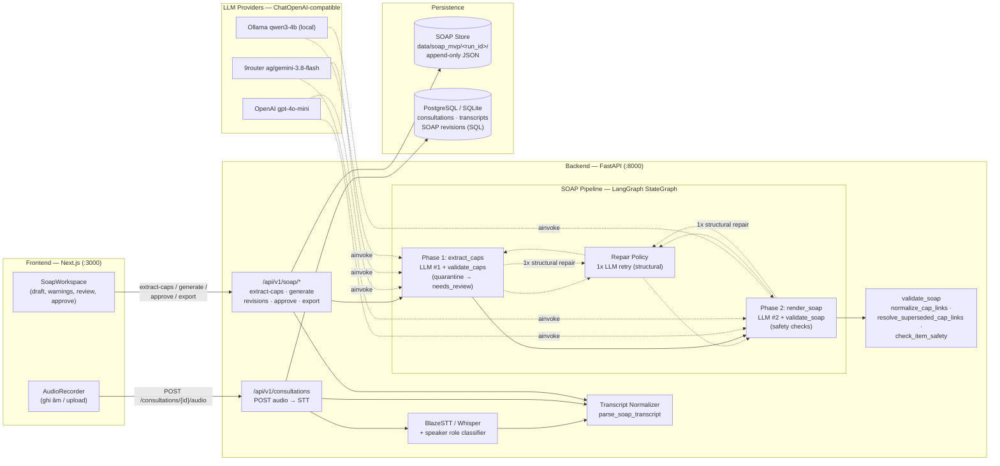

# Architecture Diagram — P-006 SOAP Clinical Note Pipeline

> Sơ đồ components + data flow khớp code hiện tại (branch `Khue`, 2026-10-02).
> Chi tiết từng tầng: `docs/TRANSCRIPT_TO_SOAP_PIPELINE.md`.

## 1. Component Diagram

## 2. Data Flow (end-to-end)

```mermaid
sequenceDiagram
    autonumber
    participant U as Bác sĩ (Frontend)
    participant BE as Backend FastAPI
    participant STT as STT + Diarization
    participant G as LangGraph Pipeline
    participant L1 as LLM #1 (Extract)
    participant L2 as LLM #2 (Render)
    participant S as SOAP Store (JSON)
    participant R as Reviewer (Frontend)

    U->>BE: POST /consultations/{id}/audio
    BE->>STT: transcribe + speaker role (patient/clinician)
    STT-->>BE: transcript turns (role-tagged)
    BE->>S: transcript.json (append-only)

    U->>BE: POST /soap/extract-caps (transcript)
    BE->>G: operation = "extract"
    G->>L1: CAP extraction (evidence quotes, speaker semantics)
    L1-->>G: CAP JSON
    G->>G: validate_caps → usable / quarantined (needs_review) + warnings
    G->>S: caps.json snapshot
    G-->>BE: run_id + CAPs + cap_warnings

    U->>BE: POST /soap/runs/{run_id}/generate
    BE->>G: operation = "generate"
    G->>G: filter_usable_caps (chỉ status "current")<br/>compute_section_candidates (S/O/A/P deterministic)
    G->>L2: render SOAP (proposition_text + candidates + warnings)
    L2-->>G: SOAP JSON draft
    G->>G: resolve_superseded_cap_links → normalize_cap_links → validate_soap<br/>(dup IDs, missing/invalid links, section source rules, item safety)
    alt Structural error (1x retry)
        G->>L2: repair (previous output + valid_cap_ids)
        G->>G: re-validate
    end
    G->>G: assign_deterministic_item_ids (S1..P1)
    G->>S: revisions/000001_*.json (status=draft)
    G-->>BE: revision + warnings (cần quyết định review)

    R->>BE: GET /soap/runs/{run_id} · PATCH /revisions
    R->>BE: POST /approve (mọi warning + item phải được quyết/support)
    BE-->>R: approved revision → GET /export (PDF/print)
```

## 3. Safety & Grounding tầng deterministic (không qua LLM)

| Tầng | Vị trí | Chặn gì |
|---|---|---|
| CAP validation | `src/services/soap/validation.py` `validate_and_partition_caps` | speaker_mismatch, invalid_quote, duplicate_prop_id, planned/future state sai → CAP quarantined `needs_review` |
| Renderer input | `filter_usable_caps` | chỉ CAP `current` được render; quarantined/superseded không vào candidate |
| Pre-validate sanitizer | `resolve_superseded_cap_links` + `normalize_cap_links` | remap superseded → replacement (đúng 1 candidate); trim/casefold cap_ids |
| SOAP validation | `validate_soap` | duplicate item/cap link, missing/invalid link, subjective/assessment/objective/plan source rules, `check_item_safety` (dosage, vitals, negation, temporality…) |
| Repair policy | `src/services/soap/repair_policy.py` | chỉ lỗi structural được LLM repair 1 lần; lỗi safety/clinical → fail-safe HITL |
| Approval | `check_approval` | mọi warning phải có quyết định, mọi item phải được review/support trước khi duyệt |

## 4. Điểm mở rộng / cấu hình

- Provider chọn qua `.env` `LLM_PROVIDER` (openai | 9router | ollama) — `src/services/llm.py`, `src/services/model_runtime.py`.
- Eval harness: `eval/soap/run_eval.py` (baseline vs CAP pipeline, artifacts `data/soap_mvp/eval/`).
- Append-only store giúp tái hiện mọi run (attempts, revisions) — dùng cho eval evidences và debug.
