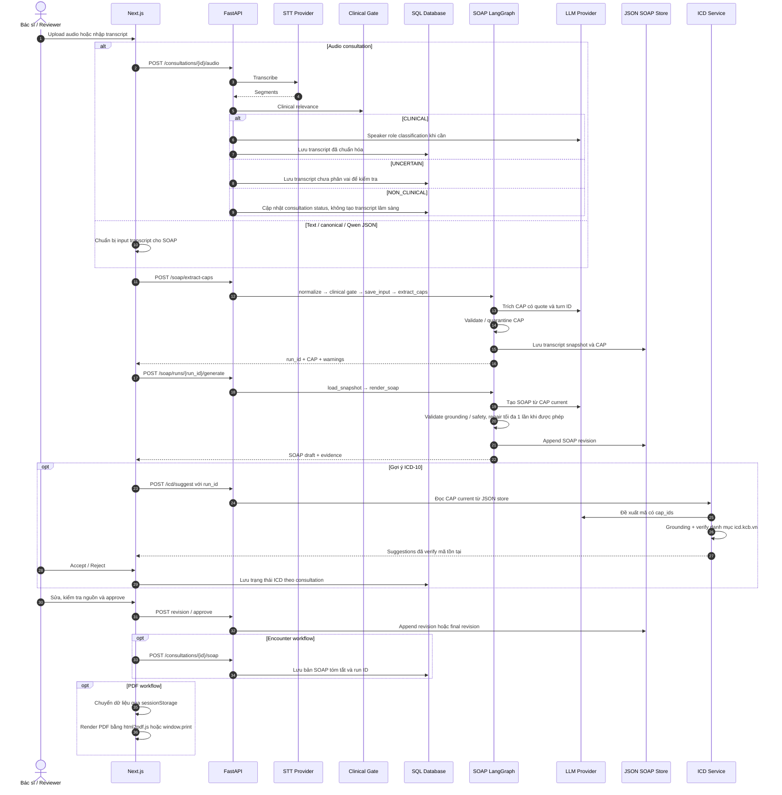
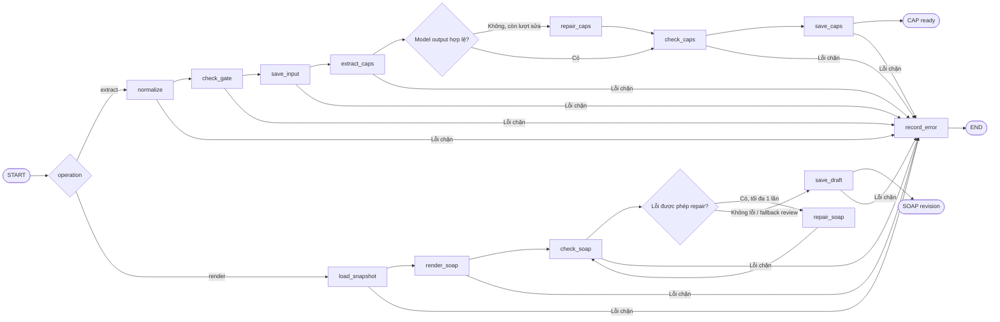

# Architecture Diagram — ClinNote AI P-006

> Tên file chuẩn theo checklist dự án: `docs/architecture_diagram.md`.
> Đối chiếu với code tại commit `8741183` ngày 2026-10-14. Sơ đồ mô tả implementation hiện có; các giới hạn nghiệm thu nằm ở cuối tài liệu.

## 1. System Overview

```mermaid
flowchart TB
    USER([Bác sĩ / Người review])

    subgraph FE["Frontend — Next.js 16 / React 19"]
        AUTHUI["Đăng nhập / Supabase session"]
        ENCOUNTER["/encounters/[id]<br/>Audio · Transcript · SOAP review"]
        SOAPUI["/soap<br/>Transcript-only / Test import"]
        SETTINGS["/settings<br/>STT · Roles · CAP · SOAP"]
        PDFUI["/encounters/[id]/pdf<br/>Preview · html2pdf / print"]
    end

    subgraph API["Backend — FastAPI :8000"]
        CORE["/api/v1<br/>Patients · Consultations · Transcript"]
        AUDIO["Audio pipeline<br/>STT → Clinical gate → Roles → Normalize"]
        SOAPAPI["/api/v1/soap<br/>Extract · Generate · Revise · Approve · Export"]
        GRAPH["LangGraph SOAP<br/>extract operation · render operation"]
        VALIDATE["Deterministic validation<br/>CAP grounding · SOAP safety · bounded repair"]
        MODELAPI["/api/v1/model-settings<br/>Catalog · Ping"]
        ICDAPI["ICD APIs<br/>Suggest · Verify · Accept / Reject"]
        CSOAP["Consultation SOAP API<br/>GET / POST summary"]
    end

    subgraph DATA["Persistence"]
        DB[("PostgreSQL / SQLite<br/>users · patients · consultations<br/>transcript_segments · soap_notes · icd_suggestions")]
        STORE[("JSON SOAP Store<br/>data/soap_mvp/&lt;run_id&gt;<br/>snapshot · CAP · attempts · revisions")]
        BROWSER[("Browser state<br/>model preferences in localStorage<br/>PDF handoff in sessionStorage")]
    end

    subgraph EXT["External / Local Providers"]
        SUPA["Supabase Auth"]
        STT["Blaze or Whisper<br/>9router / Groq"]
        JEV["Clinical gate and roles<br/>JEV / OpenRouter or configured model"]
        LLM["CAP / SOAP / ICD LLM<br/>9router · OpenAI · Ollama<br/>Gemini · OpenRouter · Groq"]
        KCB["ICD catalog<br/>Parse → icd.kcb.vn"]
    end

    USER --> AUTHUI
    USER --> ENCOUNTER
    USER --> SOAPUI
    AUTHUI <--> SUPA
    ENCOUNTER --> CORE
    ENCOUNTER --> SOAPAPI
    ENCOUNTER --> CSOAP
    ENCOUNTER --> ICDAPI
    SOAPUI --> SOAPAPI
    SOAPUI --> ICDAPI
    SETTINGS --> MODELAPI
    ENCOUNTER --> PDFUI

    CORE --> AUDIO
    AUDIO --> STT
    AUDIO --> JEV
    AUDIO --> DB

    MODELAPI --> STT
    MODELAPI --> JEV
    MODELAPI --> LLM

    SOAPAPI --> GRAPH
    GRAPH --> JEV
    GRAPH --> LLM
    GRAPH --> VALIDATE
    GRAPH --> STORE

    CSOAP --> DB
    ICDAPI --> STORE
    ICDAPI --> LLM
    ICDAPI --> KCB
    ICDAPI --> DB

    SETTINGS --> BROWSER
    ENCOUNTER --> BROWSER
    PDFUI --> BROWSER
```

Không có Vector Store hoặc RAG trong pipeline SOAP hiện tại. Backend xử lý theo request/response; chưa có SSE, WebSocket hoặc streaming token/progress.

## 2. End-to-End Data Flow

## 3. SOAP Graph

Extract và render là hai invocation riêng. Render đọc snapshot/CAP đã lưu; không chạy lại STT hoặc CAP extraction. Review, approve và export do service riêng xử lý, không đi qua graph.

## 4. Storage Ownership

| Dữ liệu | Nguồn lưu hiện tại | Ghi chú |
|---|---|---|
| Người dùng, bệnh nhân, lượt khám | SQL database | SQLAlchemy; production hướng tới PostgreSQL/Supabase |
| Transcript của consultation | SQL database | `transcript_segments`, có sửa từng segment |
| Snapshot nguồn, CAP, attempts | JSON SOAP Store | Theo `run_id`, dùng cho grounding và tái hiện |
| SOAP revision/final của run | JSON SOAP Store | Có optimistic revision check; final bất biến trong store |
| SOAP tóm tắt theo consultation | SQL database | `soap_notes`; lưu S/O/A/P và run ID trong `model_name` |
| ICD suggestion đã lưu | SQL database | Trạng thái `SUGGESTED`, `ACCEPTED`, `REJECTED` |
| Model preferences | Browser `localStorage` | Không lưu API key; key chỉ giữ trong bộ nhớ tab |
| Dữ liệu chuyển sang màn PDF | Browser `sessionStorage` | Chưa được backend đối chiếu với final revision |

JSON SOAP Store và `soap_notes` chưa có một giao dịch đồng bộ final thống nhất. Việc approve run trong JSON store không tự bảo đảm bản SQL/PDF là cùng revision.

## 5. Deployment and Security Boundary

- Frontend deploy hiện được công bố tại `https://c4-app-006.vercel.app/`; bằng chứng hiện có chỉ xác nhận `/` và `/soap` trả HTTP 200 ngày 2026-10-14.
- Backend SOAP và Model Settings chỉ mount trong `development`/`test`; SOAP còn phụ thuộc `SOAP_ENABLED=true`.
- Backend API chưa có lớp xác thực tương ứng để bảo vệ toàn bộ API bằng Supabase session. Không dùng deployment hiện tại cho hồ sơ bệnh nhân thật.
- Docker/Compose hiện không chứng minh một full-stack production deployment gồm frontend, database và model providers.

## 6. Remaining Architecture Work

- Đồng bộ transaction/revision giữa JSON final, `soap_notes` và dữ liệu PDF.
- Bắt buộc review thực tế thay vì tự gắn `reviewed/supported` khi người dùng approve.
- Thêm backend authentication/authorization và phân quyền consultation.
- Nghiệm thu browser cho audio → transcript → CAP → SOAP → approve → mở lại → PDF.
- Chỉ thêm SSE/progress hoặc streaming sau khi luồng batch và semantics revision/final ổn định.

Đọc sâu: [Transcript-to-SOAP Pipeline](TRANSCRIPT_TO_SOAP_PIPELINE.md), [SOAP Evaluation Report](../eval/soap/report.md), [README](../README.md) và [SOAP Graph](../src/agents/soap_graph.py).
