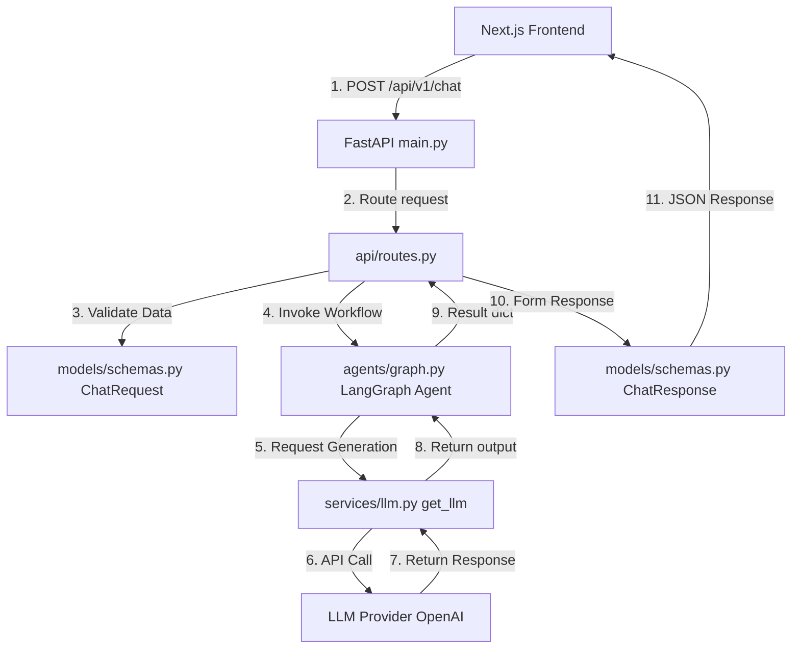

# Kiến trúc Mã nguồn Backend (`src/`) - Project VMEC-06

> **Dự án:** VMEC-06 – AI Agent Trợ lý Bác sĩ Soạn Ghi Chú Lâm Sàng (Clinical Note SOAP)  
> **Tài liệu:** Kiến trúc mã nguồn nội bộ dành cho đội ngũ phát triển.

---

## 1. Tổng quan

### 1.1 Vai trò của `src/` trong hệ thống
Thư mục `src/` là lõi xử lý **Backend & AI Core** của toàn bộ hệ thống VMEC-06:
* **Frontend**: Nằm tách biệt trong thư mục `frontend/` (xây dựng bằng Next.js, React, Tailwind CSS).
* **Backend Framework**: Sử dụng **FastAPI** để cung cấp API RESTful phục vụ giao tiếp với Frontend.
* **AI Agent Framework**: Sử dụng **LangGraph** để xây dựng và điều phối workflow AI multi-step phức tạp.
* **LLM Abstraction**: Tầng giao tiếp với mô hình ngôn ngữ lớn được trừu tượng hóa (abstraction) qua `services/llm.py`.
* **Mục tiêu hệ thống**: Xử lý toàn bộ pipeline từ hội thoại bác sĩ - bệnh nhân (transcript) đến việc bóc tách thông tin lâm sàng, chuẩn hóa dữ liệu, tra cứu mã ICD-10 và sinh Ghi chú Lâm sàng dạng **SOAP (Subjective, Objective, Assessment, Plan)** dưới sự phê duyệt của Bác sĩ.

### 1.2 Mô hình Kiến trúc Tổng quát

```text
Frontend (Next.js + React + Tailwind)
        ↓
FastAPI Backend
        ↓
LangGraph Agent
        ↓
Services / LLM / External APIs
        ↓
Clinical Processing
        ↓
SOAP / ICD-10 / Doctor Review
```

---

## 2. Giải thích từng thành phần trong `src/`

Cấu trúc hiện tại của thư mục `src/`:

```text
src/
├── agents/
│   └── graph.py
│
├── api/
│   ├── __init__.py
│   └── routes.py
│
├── models/
│   ├── __init__.py
│   └── schemas.py
│
├── services/
│   ├── __init__.py
│   └── llm.py
│
├── __init__.py
├── config.py
└── main.py
```

---

### 2.1 `agents/`

* **Trách nhiệm:** Nơi quản lý logic điều phối AI Agent bằng framework LangGraph.
* **Nguyên tắc thiết kế:**
  * Thư mục `agents/` đóng vai trò là "bộ não điều hành" (orchestrator), điều phối luồng thực thi dữ liệu qua các bước.
  * `agents/` **không** được chứa trực tiếp mã nguồn gọi API bên ngoài (ví dụ: HTTP client tới Ollama, Blaze API) hoặc truy vấn database trực tiếp.
  * Agent sẽ gọi đến các thành phần thuộc tầng `services/` khi cần thực hiện công việc cụ thể.

---

### 2.2 `agents/graph.py`

* **Trách nhiệm:** Định nghĩa và biên dịch đồ thị luồng công việc (LangGraph StateGraph).
* **Chi tiết kỹ thuật:**
  * Khai báo các **Nodes** (các bước xử lý), **Edges** (luồng chuyển tiếp) và **Conditional Edges** (luồng rẽ nhánh dựa trên điều kiện state).
  * Biên dịch đồ thị (`build_graph().compile()`) thành đối tượng `agent` sẵn sàng nhận dữ liệu thực thi.
* **Định hướng Workflow Lâm sàng VMEC-06:**
  Trong tương lai, đồ thị LangGraph của dự án sẽ điều phối luồng dữ liệu lâm sàng theo thứ tự:
  ```text
  Transcript (Bản ghi thoại)
  → Speaker Role (Phân vai Bác sĩ / Bệnh nhân)
  → Clinical Facts (Bóc tách thông tin lâm sàng)
  → Grounding / Missing Information (Kiểm chứng thông tin & Phát hiện thông tin thiếu)
  → SOAP (Sinh bản ghi SOAP)
  → ICD-10 (Gợi ý mã bệnh ICD-10)
  → Doctor Review (Bác sĩ xác nhận/chỉnh sửa)
  ```
* **Lưu ý quan trọng:** `graph.py` là nơi **ORCHESTRATE (điều phối)** workflow, tuyệt đối không biến file này thành nơi chứa toàn bộ business logic hoặc prompt template chi tiết.

---

### 2.3 `api/`

* **Trách nhiệm:** Tầng giao tiếp (API Layer) giữa Frontend và Backend.
* **Nguyên tắc thiết kế:**
  * Chứa các khai báo Web Service Endpoint của FastAPI.
  * Frontend **không** gọi trực tiếp vào LangGraph agent hay các dịch vụ nội bộ mà bắt buộc phải thông qua các endpoint trong tầng `api/`.

---

### 2.4 `api/routes.py`

* **Trách nhiệm:** Định nghĩa các đường dẫn (routes / endpoints) của hệ thống.
* **Phân tích mã nguồn hiện tại:**

```python
from fastapi import APIRouter, HTTPException

from src.agents.graph import agent
from src.models.schemas import ChatRequest, ChatResponse

router = APIRouter()

@router.post("/chat", response_model=ChatResponse)
async def chat(request: ChatRequest) -> ChatResponse:
    """Chat với AI agent."""
    try:
        result = await agent.ainvoke({"query": request.message})
        return ChatResponse(
            response=result.get("response", ""),
            analysis=result.get("analysis", ""),
        )
    except Exception as e:
        raise HTTPException(status_code=500, detail=str(e))

@router.get("/status")
async def agent_status():
    """Kiểm tra trạng thái agent."""
    return {"status": "ready", "agent": "LangGraph Agent v1.0"}
```

* **Các thành phần chính:**
  * `APIRouter`: Gom nhóm các endpoint liên quan để gắn vào FastAPI app chính.
  * `HTTPException`: Xử lý và trả về HTTP status code tương ứng (ví dụ: 500 khi có lỗi hệ thống).
  * `ChatRequest` & `ChatResponse`: Data Transfer Objects (DTO) định kiểu cho dữ liệu vào/ra.
* **Luồng xử lý của `POST /chat`:**
  1. Frontend gửi payload JSON.
  2. FastAPI tự động validate payload với `ChatRequest`.
  3. Hàm `chat()` gọi `agent.ainvoke({"query": request.message})` bất đồng bộ.
  4. Nhận kết quả từ `agent` và đóng gói thành `ChatResponse` trả về cho Frontend.
* **Lưu ý:** `routes.py` thuộc tầng API, **không nên nhét logic xử lý AI phức tạp** trực tiếp vào các hàm endpoint.

---

### 2.5 `models/`

* **Trách nhiệm:** Chứa các định nghĩa Pydantic Data Models và Schemas.
* **Vai trò:** Đóng vai trò làm **"Data Contract" (Hợp đồng dữ liệu)** thống nhất giữa Frontend, Backend và các module nội bộ.

---

### 2.6 `models/schemas.py`

* **Trách nhiệm:** Định nghĩa cụ thể các cấu trúc dữ liệu Request/Response cho API.
* **Phân tích mã nguồn hiện tại:**

```python
from pydantic import BaseModel, Field

class ChatRequest(BaseModel):
    message: str = Field(..., min_length=1, max_length=5000, description="Tin nhắn từ user")

class ChatResponse(BaseModel):
    response: str = Field(..., description="Phản hồi từ agent")
    analysis: str = Field(default="", description="Phân tích nội bộ")
```

* **Giải thích:**
  * `ChatRequest`: Đảm bảo `message` phải là chuỗi có độ dài từ 1 đến 5000 ký tự. Khi thông tin không hợp lệ, Pydantic/FastAPI sẽ tự động trả về lỗi 422 Unprocessable Entity.
  * `ChatResponse`: Quy định cấu trúc JSON phản hồi gồm `response` (nội dung phản hồi) và `analysis` (chuỗi phân tích nội bộ, mặc định là rỗng).
* **Nguyên tắc:** Không đặt business logic, truy vấn database hoặc gọi LLM trực tiếp trong `schemas.py`.

---

### 2.7 `services/`

* **Trách nhiệm:** Tầng dịch vụ (Service Layer) thực thi các tác vụ kỹ thuật chuyên biệt (giao tiếp LLM, truy vấn CSDL, tích hợp API bên ngoài, bóc tách văn bản,...).
* **Lợi ích:** Tách rời logic điều phối (Orchestration trong Agent) khỏi logic triển khai chi tiết (Implementation trong Services). Khi cần thay đổi thư viện hay provider, ta chỉ cần chỉnh sửa trong `services/`.

---

### 2.8 `services/llm.py`

* **Trách nhiệm:** Cung cấp hàm khởi tạo và cấu hình client kết nối tới Large Language Model (LLM).
* **Phân tích mã nguồn hiện tại:**

```python
from langchain_openai import ChatOpenAI
from src.config import get_settings

def get_llm() -> ChatOpenAI:
    settings = get_settings()
    return ChatOpenAI(
        model=settings.model_name,
        api_key=settings.openai_api_key,
        temperature=settings.llm_temperature,
    )
```

* **Giải thích:**
  * Hàm `get_llm()` đóng vai trò là Factory Function khởi tạo đối tượng `ChatOpenAI`.
  * Đọc các thông số cấu hình (`model_name`, `openai_api_key`, `llm_temperature`) từ `src.config`.
  * Đóng gói LLM client để các module khác (như nodes trong Agent) chỉ cần gọi `get_llm()` mà không phải tự khởi tạo lại client.
* **Tình trạng hiện tại & Định hướng tương lai:**
  * **Hiện tại:** Mã nguồn đang sử dụng `ChatOpenAI` (OpenAI API).
  * **Tương lai:** Trong kiến trúc mở rộng của VMEC-06, hệ thống có thể chuyển đổi hoặc bổ sung mô hình local (Ollama + Qwen local) nhằm phục vụ bảo mật dữ liệu y tế. Lớp abstraction `services/llm.py` giúp việc chuyển đổi này diễn ra dễ dàng mà không làm ảnh hưởng đến luồng LangGraph ở `agents/`.

---

### 2.9 `config.py`

* **Trách nhiệm:** Quản lý tập trung toàn bộ cấu hình ứng dụng (Application Configuration) và biến môi trường (Environment Variables).
* **Chi tiết mã nguồn:**
  * Sử dụng `pydantic_settings.BaseSettings` để tự động đọc cấu hình từ file `.env`.
  * Định nghĩa cấu hình ứng dụng (`app_name`, `app_port`, `cors_origins`), LLM (`model_name`, `openai_api_key`), Database (`database_url`), và Vector Store (`chroma_persist_dir`).
  * Hàm `get_settings()` sử dụng `@lru_cache` để cache instance cấu hình, tránh việc đọc file `.env` nhiều lần.
* **Nguyên tắc bảo mật:** Không được hardcode API key, secret token hay thông tin nhạy cảm trực tiếp trong source code. Tất cả phải được nạp thông qua `config.py`.

---

### 2.10 `main.py`

* **Trách nhiệm:** Entry point (điểm khởi chạy) của ứng dụng FastAPI Backend.
* **Chi tiết mã nguồn:**
  * Khởi tạo đối tượng `FastAPI` app với thông tin tên dự án và phiên bản.
  * Quản lý vòng đời ứng dụng thông qua `lifespan` context manager (thực thi tác vụ khi ứng dụng startup/shutdown).
  * Đăng ký Middleware CORS (`CORSMiddleware`) cho phép kết nối từ Frontend.
  * Đăng ký APIRouter: `app.include_router(router, prefix="/api/v1")`.
  * Cung cấp endpoint kiểm tra sức khỏe hệ thống `GET /health`.

---

## 3. Luồng Request Hiện Tại (Current Request Flow)

### 3.1 Mô tả sơ đồ luồng
1. **Frontend (Next.js)** gửi HTTP request `POST /api/v1/chat` chứa JSON payload (`{"message": "..."}`).
2. **FastAPI (`main.py`)** tiếp nhận request và chuyển hướng tới router tương ứng trong `api/routes.py`.
3. **`api/routes.py`** sử dụng Pydantic Model `ChatRequest` trong `models/schemas.py` để validate dữ liệu đầu vào.
4. Sau khi validation thành công, `routes.py` gọi hàm bất đồng bộ `agent.ainvoke({"query": request.message})` từ `agents/graph.py`.
5. **`agents/graph.py`** điều phối thực thi các nodes trong LangGraph đồ thị.
6. Trong quá trình chạy, các node gọi tới `services/llm.py` để tương tác với LLM Provider.
7. Sau khi hoàn thành workflow, `agent` trả lại kết quả dictionary gồm `response` và `analysis`.
8. `routes.py` đóng gói dữ liệu thành `ChatResponse` trả về client dưới dạng JSON HTTP Response.

### 3.2 Sơ đồ Mermaid (Sequence & Flowchart)



---

## 4. Định hướng Mở rộng trong Tương lai (Future Architecture Extensions)

Khi dự án VMEC-06 phát triển chuyên sâu hơn vào bài toán y tế, các thư mục có thể được mở rộng theo định hướng:

1. **`services/`**:
   Cấu trúc mục tiêu dành cho tầng dịch vụ (`services/`) khi mở rộng:

   ```text
   services/
   ├── blaze/
   │   ├── stt_async.py
   │   ├── stt_realtime.py
   │   ├── speaker_embedding.py
   │   └── separation.py
   │
   ├── llm/
   │   ├── ollama.py
   │   └── qwen.py
   │
   ├── speaker/
   │   ├── role_classifier.py
   │   └── segment_merger.py
   │
   ├── clinical/
   │   ├── fact_extraction.py
   │   ├── grounding.py
   │   ├── missing_info.py
   │   └── soap_generator.py
   │
   └── icd10/
       └── suggestion.py
   ```

2. **`agents/`**:
   * Phân chia `agents/graph.py` thành các sub-graphs hoặc thêm folder `agents/nodes/` và `agents/prompts/` để quản lý prompt chuyên biệt cho từng bước (SOAP, Grounding, Medical Coding).
3. **`models/`**:
   * Thêm `models/clinical.py` định nghĩa cấu trúc dữ liệu cho SOAP note, thông tin bệnh nhân, danh mục ICD-10.

*Lưu ý: Sự mở rộng này vẫn tuân thủ nguyên tắc phân tầng hiện tại của dự án.*

